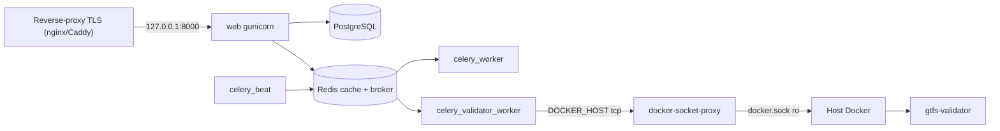

# Deployment

A complete guide to running the project in production: the Django + Celery application,
PostgreSQL, Redis, the GTFS validator and a reverse proxy with TLS.

Target environment: **a single VPS**, Docker Compose, HTTPS traffic terminated on an
external reverse proxy (nginx/Caddy). The application listens locally on
`127.0.0.1:8000` and is not exposed directly to the internet.

> Development: for local work use `docker compose up --build` (see [`README.md`](../README.md)).
> This document covers the **production** configuration (`settings_prod` + gunicorn).

---

## Table of contents

1. [Service architecture](#1-service-architecture)
2. [Prerequisites](#2-prerequisites)
3. [Getting the code](#3-getting-the-code)
4. [Generating secrets](#4-generating-secrets)
5. [The `.env` file — full configuration](#5-the-env-file--full-configuration)
6. [PostgreSQL](#6-postgresql)
7. [CORS and CSRF](#7-cors-and-csrf)
8. [Docker API for the validator (docker-socket-proxy)](#8-docker-api-for-the-validator-docker-socket-proxy)
9. [File permissions (UID/GID)](#9-file-permissions-uidgid)
10. [Startup](#10-startup)
11. [Migrations, admin account and roles](#11-migrations-admin-account-and-roles)
12. [Static files (STATIC)](#12-static-files-static)
13. [Reverse proxy + TLS](#13-reverse-proxy--tls)
14. [Deployment verification](#14-deployment-verification)
15. [Updates](#15-updates)
16. [Backups and restore](#16-backups-and-restore)
17. [Security checklist](#17-security-checklist)
18. [Troubleshooting](#18-troubleshooting)
19. [Journey planner (OpenTripPlanner)](#19-journey-planner-opentripplanner)

---

## 1. Service architecture

The `docker-compose.yml` file (base) + `docker-compose.prod.yml` (production overlay)
define the following services:

| Service | Role | Port (host) |
| --- | --- | --- |
| `web` | Django (gunicorn in prod) | `127.0.0.1:8000` |
| `postgres` | Database | `127.0.0.1:5420` (local only) |
| `redis` | Celery broker + cache | `127.0.0.1:6379` (local only) |
| `celery_worker` | `default` queue | — |
| `celery_validator_worker` | `feeds` queue + GTFS validator (via socket-proxy) | — |
| `docker-socket-proxy` | Least-privilege access to the host's Docker API | — |
| `celery_beat` | Scheduler (django-celery-beat) | — |
| `celery_planner_worker` | `planner` queue: journey planner graph builds (profile `planner`) | — |
| `otp` | OpenTripPlanner serving the planner graph (profile `planner`) | none (internal only) |
| `migrate` / `init_uploads` | Startup jobs (one-off) | — |



---

## 2. Prerequisites

- A Linux VPS (e.g. Debian/Ubuntu) with a public IP and a domain pointing to this server.
- Docker Engine + the `docker compose` plugin (v2).
- Ports `80` and `443` open (for the reverse proxy). The database/redis/web ports should
  **not** be exposed publicly (in compose they are bound to `127.0.0.1`).
- The host's Docker socket is mounted only by the `docker-socket-proxy` service (the GTFS
  validator uses it via `DOCKER_HOST`; nothing needs to be configured).

---

## 3. Getting the code

```bash
git clone <adres-repozytorium> /opt/odt
cd /opt/odt
```

---

## 4. Generating secrets

Generate all of the values below **once** and store them in a secrets manager.

```bash
# DJANGO_SECRET_KEY (long, random key)
python3 -c "import secrets; print(secrets.token_urlsafe(64))"

# FEED_AUTH_ENCRYPTION_KEY (Fernet key for encrypting feed credentials)
python3 -c "from cryptography.fernet import Fernet; print(Fernet.generate_key().decode())"
# (if you do not have 'cryptography' locally, generate it in the container after the first build:
#  docker compose run --rm web python -c "from cryptography.fernet import Fernet; print(Fernet.generate_key().decode())")

# POSTGRES_PASSWORD (strong database password)
python3 -c "import secrets; print(secrets.token_urlsafe(32))"
```

> Note: `FEED_AUTH_ENCRYPTION_KEY` encrypts feed API keys/tokens "at rest".
> If you do not set it, the credentials are stored in **plaintext** (dev mode). Once the
> key is set, **do not change it** — existing encrypted values will no longer be
> decryptable.

---

## 5. The `.env` file — full configuration

Copy the template and fill in real values:

```bash
cp .env.example .env
chmod 600 .env        # restrict access to the secrets file
```

A full production `.env` example (replace the values with your own):

```dotenv
# ───────────────────────── Django ─────────────────────────
DJANGO_SETTINGS_MODULE=OtwarteDaneTransportowe.settings_prod
DJANGO_SECRET_KEY=<wklej-wygenerowany-secret-key>
DJANGO_ALLOWED_HOSTS=api.example.org
# 127.0.0.1 and localhost are added automatically in settings_prod (healthcheck).
# TLS is terminated by the reverse proxy — the redirect in Django is disabled by default:
# DJANGO_SECURE_SSL_REDIRECT=False
# DJANGO_SECURE_HSTS_SECONDS=31536000
# DJANGO_LOG_LEVEL=INFO

# ───────────────────────── PostgreSQL ─────────────────────────
POSTGRES_DB=otwarte_dane_transportowe
POSTGRES_USER=odt
POSTGRES_PASSWORD=<wklej-silne-haslo-bazy>
# Port exposed on the host (127.0.0.1 only). Can be omitted in prod.
POSTGRES_HOST_PORT=5420

# ───────────────────────── Redis (broker + cache) ─────────────────────────
REDIS_HOST_PORT=6379
# Shared cache (realtime lock + throttling). Do NOT change the host name:
REDIS_CACHE_URL=redis://redis:6379/2

# ───────────────────────── CORS / CSRF ─────────────────────────
# Frontend origins (scheme + host, no path), comma-separated:
CORS_ALLOWED_ORIGINS=https://www.example.org,https://example.org
# Which paths are subject to CORS rules:
CORS_URLS_REGEX=^/(api|feed)/.*$
# (optional) additional origin regexes — in prod localhost is NOT allowed automatically:
# CORS_ALLOWED_ORIGIN_REGEXES=
# Origins trusted for CSRF (POST behind a TLS proxy) — full scheme://host:
CSRF_TRUSTED_ORIGINS=https://api.example.org

# ───────────────────────── Feed credential encryption ─────────────────────────
FEED_AUTH_ENCRYPTION_KEY=<wklej-klucz-Fernet>

# ───────────────────────── GTFS validator ─────────────────────────
# The Docker API goes through the docker-socket-proxy service (DOCKER_HOST in compose) —
# no host configuration (formerly DOCKER_GID) is needed.
# Validator image; defaults to a pinned release (see section 8 before bumping):
# GTFS_VALIDATOR_IMAGE=ghcr.io/mobilitydata/gtfs-validator:8.0.1
# Resource limits of the validator container:
# GTFS_VALIDATOR_MEM_LIMIT=2g
# GTFS_VALIDATOR_PIDS_LIMIT=512
# GTFS_VALIDATOR_NANO_CPUS=2000000000   # 2 vCPU (1e9 = 1 core)

# ───────────────────────── Worker memory ─────────────────────────
# Child process recycling — without it a single large feed download permanently
# raises the worker's RSS (CPython does not return freed arenas to the OS).
# CELERY_WORKER_MAX_TASKS_PER_CHILD=50
# CELERY_WORKER_MAX_MEMORY_PER_CHILD=300000   # KiB
# CELERY_WORKER_PREFETCH_MULTIPLIER=1

# Download limits. Static feeds are streamed to a temporary file,
# so MAX_FEED_FILE_SIZE_BYTES limits disk, not RAM. Realtime payloads are
# parsed in full and have their own, tighter limit.
# MAX_FEED_FILE_SIZE_BYTES=209715200
# MAX_REALTIME_FEED_BYTES=33554432
# FEED_FETCH_TOTAL_TIMEOUT_SECONDS=600
# REALTIME_FETCH_TOTAL_TIMEOUT_SECONDS=60

# ───────────────────────── File permissions ─────────────────────────
UID=1000
GID=1000
HOST_PROJECT_PATH=/opt/odt
HOST_MEDIA_ROOT=/opt/odt/uploaded_data

# ───────────────────────── Performance / Celery / gunicorn ─────────────────────────
GUNICORN_WORKERS=3
# Threads per worker (gthread). Journey planner requests wait on OpenTripPlanner,
# so threads keep the other endpoints answering meanwhile.
GUNICORN_THREADS=4
CELERY_DEFAULT_CONCURRENCY=2
# The feeds queue only handles static downloads and GTFS validations — a few tasks per
# feed per day. Each additional process is ~90 MB of RAM when idle.
CELERY_FEEDS_CONCURRENCY=1

# ───────────────────────── Limits / throttling / JWT (optional) ─────────────────────────
# MAX_IMAGE_FILE_SIZE_BYTES=10485760       # 10 MB
# DATA_UPLOAD_MAX_MEMORY_SIZE=10485760
# FILE_UPLOAD_MAX_MEMORY_SIZE=5242880
# THROTTLE_ANON=60/min
# THROTTLE_USER=240/min
# THROTTLE_LOGIN=10/min
# THROTTLE_FEED_DOWNLOAD=120/min
# JWT_ACCESS_MINUTES=15
# JWT_REFRESH_DAYS=1

# ───────────────────────── Reverse proxy (XFF trust limit) ─────────────────────────
# CIDRs of the trusted proxy (e.g. the Docker network or the proxy address) — client IPs for
# the blog reaction limit and anonymous throttling. Required: settings_prod refuses to start when empty.
TRUSTED_PROXY_CIDRS=172.16.0.0/12
# Only when the app is served directly to clients, without a reverse proxy:
# ALLOW_UNTRUSTED_PROXY_IPS=True

# ───────────────────────── Public URL (currently unused) ─────────────────────────
# Defined in settings, but no code reads it at the moment.
# PUBLIC_BASE_URL=https://api.example.org
```

### Key variables — description

| Variable | Meaning |
| --- | --- |
| `DJANGO_SETTINGS_MODULE` | **Must** be `...settings_prod` in production. |
| `DJANGO_SECRET_KEY` | The application **refuses to start** in prod if this is a placeholder. |
| `DJANGO_ALLOWED_HOSTS` | Public API domains (without `https://`). `127.0.0.1` and `localhost` are added automatically in `settings_prod`. |
| `POSTGRES_PASSWORD` | Database password — strong, unique. |
| `CORS_ALLOWED_ORIGINS` | Frontend browser origins (whitelist). |
| `CSRF_TRUSTED_ORIGINS` | Required for POST behind a TLS proxy. |
| `FEED_AUTH_ENCRYPTION_KEY` | At-rest encryption of feed credentials. |
| `REDIS_CACHE_URL` | Shared cache (realtime lock + throttling). |
| `TRUSTED_PROXY_CIDRS` | **Required behind a reverse proxy.** `X-Forwarded-For` is trusted only from these networks. Without it every visitor is seen with the proxy's address: blog reactions collapse into ONE shared reaction per post (each visitor overwrites the previous one), one shared daily limit, and one shared anonymous throttling bucket. The proxy must also forward `X-Forwarded-For`. `settings_prod` **refuses to start** (`ImproperlyConfigured`) when it is empty, unless `ALLOW_UNTRUSTED_PROXY_IPS=True`. In other `DEBUG=False` configurations a missing value is reported by `manage.py check` as `blog.W001`. |
| `ALLOW_UNTRUSTED_PROXY_IPS` | Default `False`. Set to `True` only when the app is served directly to clients without a reverse proxy: it disables the startup check for an empty `TRUSTED_PROXY_CIDRS`, and the client IP is then taken from the socket address (`REMOTE_ADDR`). |
| `PUBLIC_BASE_URL` | Currently unused (defined in settings, not read by any code). |
| `UID` / `GID` | User the application containers run as, and the user of the GTFS validator container, so it can write its report into `uploaded_data/`. Default `1000`. |
| `HOST_PROJECT_PATH` / `HOST_MEDIA_ROOT` | Host paths of the project and of `uploaded_data/`. The validator is started by the host's Docker daemon, so its bind mounts need host paths. Compose passes `${PWD}` and `${PWD}/uploaded_data` when unset; outside compose `HOST_MEDIA_ROOT` defaults to `HOST_PROJECT_PATH/uploaded_data`. |
| `GTFS_VALIDATOR_MEM_LIMIT`, `GTFS_VALIDATOR_PIDS_LIMIT`, `GTFS_VALIDATOR_NANO_CPUS` | Resource limits of the validator container. Defaults `2g`, `512` and no CPU cap (`1000000000` = one core). |
| `CELERY_BROKER_URL` / `CELERY_RESULT_BACKEND` | Redis databases of the Celery broker and result backend. `docker-compose.yml` sets them to `redis://redis:6379/0` and `/1`, which overrides `.env`; the defaults (`redis://localhost:6379/0`, `/1`) are for running outside Docker. |
| `POSTGRES_HOST` / `POSTGRES_PORT` | Database address. `docker-compose.yml` sets `postgres` and `5432`; the defaults `127.0.0.1` and `5420` (the port published on the host) are for running on the host. |
| `DJANGO_MEDIA_ROOT` | Directory of uploaded and cached feed files and blog images inside the containers. Default `uploaded_data/` in the project directory; if you change it, `HOST_MEDIA_ROOT` must still point to the same directory on the host. |
| `DJANGO_SECURE_REFERRER_POLICY` | `Referrer-Policy` header in `settings_prod`. Default `same-origin`. |
| `DJANGO_SECURE_COOP` | `Cross-Origin-Opener-Policy` header in `settings_prod`. Default `same-origin`. |
| `DJANGO_DEBUG` | Does **not** switch debug mode: `settings_dev` always sets `DEBUG=True` and `settings_prod` `DEBUG=False`. It is read only in `settings_base.py`, where `true` lets every `http://localhost:<port>` and `http://127.0.0.1:<port>` origin pass CORS and ignores `CORS_ALLOWED_ORIGIN_REGEXES`, under `settings_prod` too. Never set it in production. |

---

## 6. PostgreSQL

- On the Docker network the application connects via `POSTGRES_HOST=postgres:5432` (hard-coded
  in compose). The `POSTGRES_DB/USER/PASSWORD` variables are injected into both
  the database container and the application.
- On the host the database is exposed only on `127.0.0.1:${POSTGRES_HOST_PORT:-5420}`
  (not visible from the internet). In prod you can remove the port mapping entirely if you
  do not need access from the host.
- Data is kept in the `odt_pgdata` volume (it survives container restarts/recreation).

### Changing the password of an existing database

If you change `POSTGRES_PASSWORD` **after** the first startup, the environment variable
alone will not change the password in an already initialized volume. Run:

```bash
docker compose exec postgres psql -U "$POSTGRES_USER" -d "$POSTGRES_DB" \
  -c "ALTER USER \"$POSTGRES_USER\" WITH PASSWORD 'NOWE_HASLO';"
# then update .env and restart the application services
```

### Tuning (optional)

For larger deployments consider setting `shared_buffers`, `work_mem` etc. via
`command:` or by mounting your own `postgresql.conf`. The default `postgres:16` image
is sufficient to start with.

---

## 7. CORS and CSRF

CORS is handled by `django-cors-headers`. Rules:

- **`CORS_ALLOWED_ORIGINS`** — list of allowed frontend origins (scheme + host),
  e.g. `https://www.example.org`. This is the main whitelist mechanism in production.
- **`CORS_URLS_REGEX`** — which paths are subject to CORS. Default `^/(api|feed)/.*$`.
- **`CORS_ALLOWED_ORIGIN_REGEXES`** — in production it does **not** automatically allow
  `localhost` (that behavior is dev-only). If you need patterns, set them explicitly.
- **`CSRF_TRUSTED_ORIGINS`** — required for POST requests from forms/sessions to pass
  CSRF verification behind a TLS-terminating proxy. Provide the full `scheme://host`
  (e.g. `https://api.example.org`).

> The proxy **must** forward the `X-Forwarded-Proto: https` header — the application uses
> `SECURE_PROXY_SSL_HEADER` to recognize HTTPS. Without it `Secure` cookies and CSRF
> may not work correctly.

---

## 8. Docker API for the validator (docker-socket-proxy)

The `celery_validator_worker` service runs the GTFS validator as a container through the
`docker-socket-proxy` service (`tecnativa/docker-socket-proxy`). Only the proxy
mounts `/var/run/docker.sock` (read-only); the worker connects via
`DOCKER_HOST=tcp://docker-socket-proxy:2375`, and only the
`CONTAINERS`/`IMAGES` (+`POST`) endpoints are allowed. Nothing needs to be configured on the host.

Both images are pinned: the proxy in `docker-compose.yml`, the validator through
`GTFS_VALIDATOR_IMAGE` (default in `OtwarteDaneTransportowe/settings_base.py`). A new
validator release can add, remove or reclassify notices, so the same feed may pass
before and fail after. To upgrade, read the
[release notes](https://github.com/MobilityData/gtfs-validator/releases), run a few
real feeds through the new tag, then bump the default in code (or set the variable
in `.env` and recreate the worker with `./scripts/deploy.sh up -d celery_validator_worker`;
a plain `restart` does not re-read `.env`). Pull the new image on the host first
(`docker pull <image>`): otherwise the first validation pulls it inside the task, and on a
slow link it can hit the task's time limit and reject the submission. Published feeds are
not unpublished by a failed revalidation.

> ⚠️ **Security (honestly):** the proxy cuts off exec/volumes/networks/secrets,
> but the `containers create` API still accepts bind mounts and the `privileged` flag,
> so a compromised worker remains dangerous — the attack surface is reduced,
> not eliminated. Full closure: rootless Docker or the validator as a
> separate microservice. Additional mitigations for the validator container:
> `network_disabled`, non-root, `--rm`, `mem/pids/cpu` limits.

---

## 9. File permissions (UID/GID)

The `uploaded_data/` directory is mounted as a bind mount. To avoid files
owned by root:

- Set `UID`/`GID` in `.env` to the user who should be the owner
  (usually `1000:1000`). The application runs as `${UID}:${GID}`.
- The `init_uploads` service automatically runs `chown -R` on `uploaded_data/` at
  startup (`scripts/docker-init-uploads.sh`).
- `HOST_PROJECT_PATH` and `HOST_MEDIA_ROOT` must point to the **actual paths on the
  host** (needed by the validator for the input/output bind mounts).

Checking your own UID/GID:

```bash
id -u   # UID
id -g   # GID
```

---

## 10. Startup

In production we run with the `docker-compose.prod.yml` overlay applied (gunicorn +
`settings_prod`). The simplest way is via the script:

```bash
cp .env.example .env    # if you do not have .env yet
# fill in .env (see section 5), then:
chmod +x scripts/deploy.sh
./scripts/deploy.sh up -d --build
./scripts/deploy.sh ps
```

Manually (equivalent):

```bash
# Build the image and start in the background
docker compose -f docker-compose.yml -f docker-compose.prod.yml up -d --build
```

To avoid repeating `-f` with every command, export:

```bash
export COMPOSE_FILE=docker-compose.yml:docker-compose.prod.yml
docker compose up -d --build
docker compose ps
```

> **Passwords and keys in `.env`:** the values are loaded via `env_file`, so they may
> contain the `$` character without double escaping. Avoid writing secrets as
> `${POSTGRES_PASSWORD}` in compose files — this caused warnings such as
> `The "o" variable is not set`.

The startup order is enforced by dependencies: `init_uploads` → `postgres`/`redis`
(healthcheck) → `migrate` → `web`/workers.

---

## 11. Migrations, admin account and roles

Migrations run automatically in the `migrate` service at startup. The role groups
(`Admin`, `Blogger`, `Editor`, `DataProvider`, `Helper`) are created by the
`cases/0004_create_auth_role_groups` migration — you **do not need** to create them manually.

Create the first administrator account:

```bash
docker compose exec web python manage.py createsuperuser
```

You assign roles in the `/admin/` panel (Groups) or via the user management API
(`/api/users/`, requires the `Admin` group).

Manual migrations (if needed):

```bash
docker compose exec web python manage.py migrate
```

---

## 12. Static files (STATIC)

Static files (CSS/JS for the `/admin/` panel, DRF and Swagger UI) are served
directly by the application using **WhiteNoise** — they do not require a separate
file server. Configuration:

- `STATIC_URL = '/static/'`, `STATIC_ROOT = staticfiles/` (`settings_base.py`).
- `whitenoise.middleware.WhiteNoiseMiddleware` right after `SecurityMiddleware`.
- `STATIC` is **public** (no login) — this is intentional; it covers only
  Django/DRF frontend assets, not user data.

### Generating the files (`collectstatic`)

The image runs `collectstatic` at build time, but in dev/server mode with the
bind mount (`.:/app`) the host **shadows** the directory from the image. That is why the
`migrate` service in `docker-compose.yml` runs `collectstatic` on **every** startup:

```yaml
command: sh -c "python manage.py migrate && python manage.py collectstatic --noinput"
```

As a result, after `git pull` + `up` the files land in `./staticfiles/` on the host and are
visible to WhiteNoise. If needed, it can be run manually:

```bash
docker compose exec web python manage.py collectstatic --noinput
```

### STATIC vs MEDIA

| Path | Content | Access |
| --- | --- | --- |
| `/static/...` | Admin CSS/JS, DRF, Swagger | Public (WhiteNoise) |
| `/internal-media/blog/...` | Blog post images | Public |
| `/internal-media/...` (feeds) | Feed files | Only through authorized download endpoints |

### Verification

```bash
# On the host (directly to the application)
curl -I http://127.0.0.1:8000/static/admin/css/base.css

# Through the reverse proxy / domain
curl -I https://api.example.org/static/admin/css/base.css
```

Both should return **`200`**. If you get `200` locally but `404` through the domain,
the reverse proxy is not forwarding the `/static/` path (see
[section 13](#13-reverse-proxy--tls)).

---

## 13. Reverse proxy + TLS

The application listens on `127.0.0.1:8000`. Put a reverse proxy with TLS in front of it.

### Option A: Caddy (automatic Let's Encrypt)

`/etc/caddy/Caddyfile`:

```caddy
api.example.org {
    reverse_proxy 127.0.0.1:8000 {
        header_up X-Forwarded-Proto {scheme}
        header_up X-Forwarded-For {remote_host}
    }
}
```

### Option B: nginx + certbot

```nginx
server {
    listen 443 ssl;
    server_name api.example.org;

    ssl_certificate     /etc/letsencrypt/live/api.example.org/fullchain.pem;
    ssl_certificate_key /etc/letsencrypt/live/api.example.org/privkey.pem;

    client_max_body_size 210m;   # >= MAX_FEED_FILE_SIZE_BYTES

    location / {
        proxy_pass http://127.0.0.1:8000;
        proxy_set_header Host              $host;
        proxy_set_header X-Real-IP         $remote_addr;
        proxy_set_header X-Forwarded-For   $proxy_add_x_forwarded_for;
        proxy_set_header X-Forwarded-Proto $scheme;   # REQUIRED
    }
}

server {
    listen 80;
    server_name api.example.org;
    return 301 https://$host$request_uri;
}
```

> Set `client_max_body_size` (nginx) with headroom above `MAX_FEED_FILE_SIZE_BYTES`,
> otherwise the proxy will reject large uploads before they reach the application.

If the proxy does not run on the same host as the application, change the `web` port bind
in compose (`WEB_HOST_BIND` / `WEB_HOST_PORT`) so that it is reachable by the proxy
(e.g. `WEB_HOST_BIND=0.0.0.0`).

> The proxy must forward **all** traffic to the application, including the `/static/` path
> (the `location /` above ensures this). If you use only rules such as
> `location /api/`, static files (admin/Swagger CSS) will not reach Django.

---

## 14. Deployment verification

```bash
# Service status and healthcheck
docker compose ps

# Application and worker logs
docker compose logs -f web
docker compose logs -f celery_validator_worker

# Security configuration check (inside the container, prod)
docker compose exec web python manage.py check --deploy
```

Expected: no `security.W*` warnings. Then check through the browser/proxy:

- `https://api.example.org/admin/` — login panel,
- `https://api.example.org/api/...` — API responses,
- HTTPS headers (HSTS) visible in the response.

---

## 15. Updates

```bash
cd /opt/odt
git pull

# Rebuild and recreate the services (migrations will run automatically)
./scripts/deploy.sh up -d --build

# (when needed) manual migrations
./scripts/deploy.sh exec web python manage.py migrate
```

After changing dependencies (`pyproject.toml` and `uv.lock`) or the `Dockerfile`, a build is required.

To roll back to an older version, first reverse the migrations it does not know about
(`./scripts/deploy.sh exec web python manage.py migrate <app> <last migration of the old version>`),
then deploy the old code: old code often cannot write to a schema migrated forward
(for example, columns that became `NOT NULL`). Check `docs/api/changelog.md` for
release-specific steps.

---

## 16. Backups and restore

### Database

```bash
# Backup
docker compose exec -T postgres pg_dump -U "$POSTGRES_USER" "$POSTGRES_DB" \
  | gzip > backup_$(date +%F).sql.gz

# Restore
gunzip -c backup_YYYY-MM-DD.sql.gz \
  | docker compose exec -T postgres psql -U "$POSTGRES_USER" -d "$POSTGRES_DB"
```

### Files (uploaded_data)

```bash
tar czf uploaded_data_$(date +%F).tar.gz uploaded_data/
```

> Also secure `.env` (secrets) and the **`FEED_AUTH_ENCRYPTION_KEY` key** — without
> it you will not be able to decrypt stored feed credentials after restoring the database.

---

## 17. Security checklist

- [ ] `DJANGO_SETTINGS_MODULE=OtwarteDaneTransportowe.settings_prod`
- [ ] `DJANGO_SECRET_KEY` — strong, unique (not a placeholder)
- [ ] `DJANGO_ALLOWED_HOSTS` restricted to the real domain
- [ ] `POSTGRES_PASSWORD` — strong, unique
- [ ] `FEED_AUTH_ENCRYPTION_KEY` set and archived in a vault
- [ ] `CSRF_TRUSTED_ORIGINS` + `CORS_ALLOWED_ORIGINS` narrowed to the frontend
- [ ] Reverse proxy forwards `X-Forwarded-Proto: https`
- [ ] `TRUSTED_PROXY_CIDRS` set to the reverse proxy's addresses (production refuses to start without it)
- [ ] `postgres`/`redis`/`web` ports not exposed publicly (`127.0.0.1` only)
- [ ] `docker-socket-proxy` running; rootless Docker / a separate validator microservice considered
- [ ] `.env` with `600` permissions, outside the git repository
- [ ] `python manage.py check --deploy` without `security.W*` warnings
- [ ] `/static/` files accessible (200) locally and through the proxy (see
      [section 12](#12-static-files-static))
- [ ] Backup of the database and `uploaded_data/` configured

---

## 18. Troubleshooting

**The application does not start, `ImproperlyConfigured: DJANGO_SECRET_KEY...`**
→ Set a real `DJANGO_SECRET_KEY` in `.env` (in prod the placeholder is blocked).

**The application does not start, `ImproperlyConfigured: TRUSTED_PROXY_CIDRS is empty...`**
→ Set `TRUSTED_PROXY_CIDRS` to the reverse proxy network(s). Only if the app is served
directly to clients without a proxy, set `ALLOW_UNTRUSTED_PROXY_IPS=True` instead.

**`DisallowedHost` / 400**
→ Add the public API domain to `DJANGO_ALLOWED_HOSTS` (without `https://`).
`127.0.0.1` and `localhost` are added automatically in `settings_prod`.

**The `web` container is `unhealthy` even though gunicorn is running**
→ Make sure you are using `./scripts/deploy.sh` (prod overlay). In older
versions the cause was `SECURE_SSL_REDIRECT=True` (the healthcheck goes over HTTP) —
it now defaults to `False` in `settings_prod`.

**`Control server error: Permission denied: '/.gunicorn'`**
→ Fixed in the image (`HOME=/app`, `--no-control-socket`). Rebuild the image:
`./scripts/deploy.sh up -d --build`.

**Compose warnings: `The "o" variable is not set`**
→ Secrets in `.env` must not be substituted via `${VAR}` in compose — use
`env_file` (the project default). Passwords may contain `$` without escaping.

**CSRF 403 on POST**
→ Fill in `CSRF_TRUSTED_ORIGINS` and make sure the proxy sends `X-Forwarded-Proto`.

**CORS — the browser blocks requests**
→ Add the frontend origin to `CORS_ALLOWED_ORIGINS`; check `CORS_URLS_REGEX`.

**No CSS in `/admin/` or Swagger (`/static/` files return 404)**
→ Run `collectstatic` (the `migrate` service does this at startup; manually:
`docker compose exec web python manage.py collectstatic --noinput`). If locally
`curl http://127.0.0.1:8000/static/admin/css/base.css` returns `200`, but through the domain
`404` — the reverse proxy is not forwarding `/static/` (see sections
[12](#12-static-files-static) and [13](#13-reverse-proxy--tls)).

**GTFS validation does not work / "Cannot connect to Docker"**
→ Check that the `docker-socket-proxy` service is running (`docker compose ps`,
`docker compose logs docker-socket-proxy`) and that `celery_validator_worker`
has `DOCKER_HOST=tcp://docker-socket-proxy:2375`.

**Files in `uploaded_data/` are owned by root / cannot write**
→ Set `UID`/`GID` in `.env` and reload (the `init_uploads` service will run `chown`).

**Realtime feeds do not refresh / the lock does not work**
→ Make sure `REDIS_CACHE_URL` is set (a shared cache is
required for the lock and throttling across processes).

**Blog reactions: everyone overwrites each other's reaction / one reaction globally**
→ The backend sees everyone with a single IP (the proxy's address). Set `TRUSTED_PROXY_CIDRS`
to the proxy network (e.g. `172.16.0.0/12,127.0.0.1/32`) and make sure nginx/Caddy
forwards `X-Forwarded-For`. Verification: `docker compose exec web python
manage.py check` must not report `blog.W001`.

**Large uploads fail with error 413**
→ Increase `client_max_body_size` in nginx and, if needed, `MAX_FEED_FILE_SIZE_BYTES`.

### GTFS validation hangs at "Step 2: Data verification"

Validation runs in the `celery_validator_worker` worker (`feeds` queue).
The worker talks to the Docker API through the `docker-socket-proxy` service
(`DOCKER_HOST=tcp://docker-socket-proxy:2375`) — no host configuration is
needed; only the proxy mounts the socket (read-only).

1. Make sure the proxy is running:
   ```bash
   docker compose up -d docker-socket-proxy celery_validator_worker
   docker compose ps docker-socket-proxy
   ```

2. Check the logs:
   ```bash
   docker compose logs celery_validator_worker --tail 50
   ```
   The error `Cannot connect to Docker` = the proxy is not running or `DOCKER_HOST`
   is missing from the worker's environment (see `docker-compose.yml`).

3. Retry validation for submissions stuck at stage 2:
   ```bash
   docker compose exec web python manage.py retry_gtfs_validation
   docker compose exec web python manage.py retry_gtfs_validation --submission-id 64
   ```

This applies to GTFS feeds only (NeTEx/other are not validated automatically and stay at stage 2
until a Helper/Admin sets the stage). After successful validation the stage moves to **3**; after GTFS
errors — rejection (`is_rejected`, stage 1).

---

## 19. Journey planner (OpenTripPlanner)

The journey planner ([ADR 0008](architecture/decisions/0008-journey-planner-on-private-opentripplanner.md), [ADR 0009](architecture/decisions/0009-planner-graph-build-pipeline.md)) adds two services in the compose profile `planner`:

- `otp`: OpenTripPlanner serving the active graph. It has no published port and sits on the `planner` network with `web` and the planner worker only (not with Postgres, Redis or the Docker proxy). It needs outbound internet for the realtime URLs of feeds that ODT does not proxy.
- `celery_planner_worker`: the `planner` queue. It builds graphs in short-lived OTP containers through `docker-socket-proxy` (no network, the app's UID:GID, memory limits) and stops/starts `odt-otp`.

Without the profile, nothing of the planner runs and the rest of ODT is unchanged.

### Sizing (measured 2026-10-12, OTP 2.10.0, all of Poland)

| Step | Memory | Time (swap in RAM) |
| --- | --- | --- |
| Serving, 36 feeds, OSM cropped to stops (`-Xmx6g`) | ~7 GB container (5 GB heap ran out under load) | starts in ~45 s |
| Graph build (`--loadStreet`) | ~15 GB (8 GB RAM + 7 GB swap) | ~13 min |
| Street graph (only when OSM, OTP image or feed area change) | ~13 GB (8 GB RAM + 5 GB swap) | ~8 min |
| Single-feed test (largest: Warsaw) | ~6 GB | ≤ 30 s |

- **Builds and the planner never use memory at the same time.** A build stops the serving OTP first (maintenance window; the OTP-backed endpoints answer `503`), so the server needs RAM for the app stack plus ~7 GB, and swap for the rest of a build.
- **Production VPS.** It has 11 GB RAM, so it needs **at least 10 GB of swap**. Build times on disk swap are longer than in the table and should be measured on the first build.
- **Disk.** Two graphs (~2 GB each), the street graph (~1.3 GB), the OSM extract (~2 GB for Poland) and snapshots of every feed's last good version (~0.5 GB).

### First run

```bash
# 1. Secrets and settings in .env (see .env.example, "Journey planner")
python3 -c "import secrets; print(secrets.token_urlsafe(32))"   # -> PLANNER_INTERNAL_TOKEN
# COMPOSE_PROFILES=planner and, on the host, HOST_PLANNER_DATA_DIR=/opt/odt/planner_data

# 2. The OSM extract the street graph is built from (Geofabrik, ~2 GB for Poland)
mkdir -p planner_data/osm
curl -L -o planner_data/osm/region.osm.pbf.tmp https://download.geofabrik.de/europe/poland-latest.osm.pbf
mv planner_data/osm/region.osm.pbf.tmp planner_data/osm/region.osm.pbf

# 3. Start the services
./scripts/deploy.sh up -d --build
```

Then, in the admin panel (or the admin API under `/api/planner/admin/`):

1. Add the feeds: one feed per service, because duplicates double the trips.
2. Set the schedule.
3. Build now.

The first build also builds the street graph. Until then `otp` waits for a graph instead of restarting.

### Public API

- **Off by default.** The public API (`/api/planner/v1/`) ships switched off. Turn it on with `PATCH /api/planner/admin/settings/ {"public_api_enabled": true}` once a graph is served; limits are edited there too.
- **CORS.** Any origin may call `/api/planner/v1/` (configured in code, not through `CORS_ALLOWED_ORIGINS`).
- **Concurrency.** Each gunicorn worker sends at most 2 queries to OTP at once (`MAX_CONCURRENT_QUERIES` in `planner/otp_runtime.py`); a request that finds no free slot within a second gets `503 planner.busy`. With `GUNICORN_WORKERS=3` that is 6 parallel OTP queries, what the serving sizing above was measured with. More workers mean more parallel OTP queries and more OTP memory.
- **Client IPs.** Rate limits, bans and the request log rely on correct client IPs: `TRUSTED_PROXY_CIDRS` must list every proxy hop (see section 5).
- **Request log retention.** The request log keeps raw rows, which include IP addresses, for `PLANNER_REQUEST_LOG_RETENTION_DAYS` (default 30). The beat task `planner.maintain_request_logs` (00:30 UTC) summarises each finished day without IPs and then deletes expired rows.

### Operations

- **Status and logs.** Build status, per-feed outcomes and OTP's log excerpts are in `GET /api/planner/admin/builds/{id}/`; worker logs are in `./scripts/deploy.sh logs celery_planner_worker`.
- **Failed builds.** A failed build leaves the previous graph serving. `POST /api/planner/admin/builds/{id}/activate/` serves an earlier graph again (only the served one and the newest other one are kept).
- **Deploys.** Do not deploy during the build window: `up -d` would start `otp` next to the build. If a worker dies mid-build anyway, the watchdog marks the build `build_interrupted` within ~15 minutes and restarts the active graph.
- **New OSM.** Replace `planner_data/osm/region.osm.pbf` atomically (download to a temporary name, then `mv`); the next build rebuilds the street graph.
- **New OTP version.**
  1. Change `PLANNER_OTP_IMAGE` in `.env`.
  2. Run `up -d` so the serving container uses the new image too.
  3. Build now: the next build re-tests every feed and rebuilds the street graph, and graphs built with the old image can no longer be activated.
- **Backups.** Back up `planner_data/snapshots/` (the last good version of each feed cannot be recreated). Graphs, the street graph and the OSM extract can be rebuilt or downloaded again.
