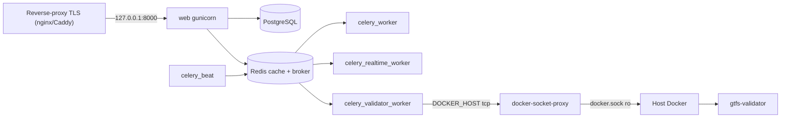
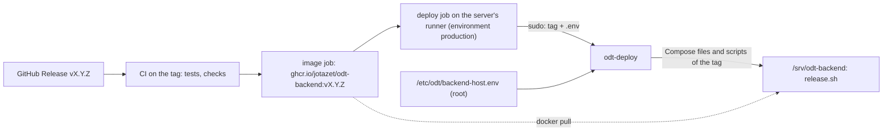

# Deployment

A complete guide to running the project in production: the Django + Celery application,
PostgreSQL, Redis, the GTFS validator and a reverse proxy with TLS.

Target environment: **a single VPS**, Docker Compose, HTTPS traffic terminated on an
external reverse proxy (nginx/Caddy). The application listens locally on
`127.0.0.1:8000` and is not exposed directly to the internet.

> Development: for local work use `docker compose up --build` (see [`README.md`](../README.md)).
> This document covers the **production** configuration (`settings_prod` + gunicorn).

---

## Table of contents

1. [Service architecture](#1-service-architecture)
2. [Prerequisites](#2-prerequisites)
3. [Getting the code](#3-getting-the-code)
4. [Generating secrets](#4-generating-secrets)
5. [The `.env` file — full configuration](#5-the-env-file--full-configuration)
6. [PostgreSQL](#6-postgresql)
7. [CORS and CSRF](#7-cors-and-csrf)
8. [Docker API for the validator (docker-socket-proxy)](#8-docker-api-for-the-validator-docker-socket-proxy)
9. [File permissions (UID/GID)](#9-file-permissions-uidgid)
10. [Startup](#10-startup)
11. [Migrations, admin account and roles](#11-migrations-admin-account-and-roles)
12. [Static files (STATIC)](#12-static-files-static)
13. [Reverse proxy + TLS](#13-reverse-proxy--tls)
14. [Deployment verification](#14-deployment-verification)
15. [Updates](#15-updates)
16. [Backups and restore](#16-backups-and-restore)
17. [Security checklist](#17-security-checklist)
18. [Troubleshooting](#18-troubleshooting)
19. [Journey planner (OpenTripPlanner)](#19-journey-planner-opentripplanner)
20. [Releases: automatic deployment from GitHub](#20-releases-automatic-deployment-from-github)

---

## 1. Service architecture

The `docker-compose.yml` file (base) + `docker-compose.prod.yml` (production overlay)
define the following services:

| Service | Role | Port (host) |
| --- | --- | --- |
| `web` | Django (gunicorn in prod) | `127.0.0.1:8000` |
| `postgres` | Database | none in production; `127.0.0.1:5420` in development |
| `redis` | Celery broker + cache | none in production; `127.0.0.1:6379` in development |
| `celery_worker` | `default` queue: the dispatchers and other short tasks | — |
| `celery_realtime_worker` | `realtime` queue: realtime fetches and verifications | — |
| `celery_validator_worker` | `feeds` queue + GTFS validator (via socket-proxy) | — |
| `docker-socket-proxy` | Least-privilege access to the host's Docker API | — |
| `celery_beat` | Scheduler (django-celery-beat) | — |
| `celery_planner_worker` | `planner` queue: journey planner graph builds (profile `planner`) | — |
| `otp` | OpenTripPlanner serving the planner graph (profile `planner`) | none (internal only) |
| `migrate` / `init_uploads` | Startup jobs (one-off) | — |



### Memory limits and logs

The host is shared and tight on memory: the serving OTP holds ~7 GB of the VPS's 11 GB, and graph
builds push available RAM down to 0.4 GB ([section 19](#19-journey-planner-opentripplanner)).
The application services, Postgres, Redis and OTP therefore have a `mem_limit`. It is a ceiling, not a reservation:
a runaway process is killed inside its own container (and restarted) instead of draining the
host, where the memory guard would kill OTP first. Docker also lets a limited container
use as much swap as its `mem_limit`.

| Service | Limit | Variable | What it has to fit |
| --- | --- | --- | --- |
| `web` | 1 GB | `WEB_MEM_LIMIT` | gunicorn master + `GUNICORN_WORKERS` (3) Django processes |
| `celery_worker` | 1 GB | `CELERY_DEFAULT_MEM_LIMIT` | main process + `CELERY_DEFAULT_CONCURRENCY` (2) children, each recycled above `CELERY_WORKER_MAX_MEMORY_PER_CHILD` (~300 MB) after its task |
| `celery_realtime_worker` | 1 GB | `CELERY_REALTIME_MEM_LIMIT` | main process + `CELERY_REALTIME_CONCURRENCY` (2) children, recycled like the above; a realtime body of up to 32 MB is parsed in full |
| `celery_validator_worker` | 1 GB | `CELERY_FEEDS_MEM_LIMIT` | main process + one child that loads the validator's JSON report (the validator itself runs in its own container, `GTFS_VALIDATOR_MEM_LIMIT`) |
| `celery_planner_worker` | 6 GB | `CELERY_PLANNER_MEM_LIMIT` | `osmium` filtering and cropping the OSM extract for a new street graph, in this container: for all of Poland (2.1 GB PBF) the crop was killed at 4 GB and fit in 5 GB without swap (measured 2026-11-12). It runs while the serving OTP is stopped. Graph builds run in their own containers (`PLANNER_OTP_*_LIMIT`) |
| `celery_beat` | 256 MB | — | one Django process |
| `postgres` | 1 GB | `POSTGRES_MEM_LIMIT` | default `shared_buffers` (128 MB) and ~20 connections; the page cache inside the limit is reclaimed before anything is killed |
| `redis` | 512 MB | — | broker queues and the cache |
| `otp` | 7 GB | `PLANNER_OTP_SERVE_MEM_LIMIT` | [section 19](#19-journey-planner-opentripplanner) |

Idle in development (2026-11-12): `web` with gunicorn ~220 MB after a few requests,
`celery_worker` ~165 MB, `celery_validator_worker` ~110 MB, `celery_beat` ~90 MB, `postgres`
~35 MB, `redis` ~15 MB. The limits leave room for peaks on top of that but are not yet
measured under production load. Compare them with the
real usage (`./scripts/deploy.sh stats --no-stream`) and raise one in the
[host file](#the-host-file) if a service gets close. A container killed by its limit shows
`OOMKilled=true` in `docker inspect --format '{{.State.OOMKilled}}' <container>`.

Every service logs through Docker's `json-file` driver with rotation: at most 5 files of
10 MB per container, the rotated ones gzipped, so `docker compose logs` keeps the last ~50 MB
of log lines of each in well under that on disk. The busiest is `celery_realtime_worker`: Celery logs
two INFO lines per realtime poll. Containers that the workers start themselves (the
validator, graph builds) use the Docker daemon's default log settings, which do not rotate
unless `/etc/docker/daemon.json` sets `log-opts`; they run for minutes and are removed with
their logs when they finish.

---

## 2. Prerequisites

- A Linux VPS (e.g. Debian/Ubuntu) with a public IP and a domain pointing to this server.
- Docker Engine + the `docker compose` plugin (v2).
- Ports `80` and `443` open (for the reverse proxy). The web port is bound to `127.0.0.1`;
  the production overlay publishes no port for the database and Redis
  ([section 6](#6-postgresql)).
- The host's Docker socket is mounted only by the `docker-socket-proxy` service (the GTFS
  validator uses it via `DOCKER_HOST`; nothing needs to be configured).

---

## 3. Getting the code

Production needs no clone: each release downloads its Compose files and deploy scripts
into the **deployment directory** `/srv/odt-backend`, owned by the system user `odt`, and
runs the image CI built for it
([section 20](#20-releases-automatic-deployment-from-github)). That directory also holds
`.env`, `uploaded_data/` and `planner_data/`; the commands in this guide run from there.

To build and run by hand instead (another host, development):

```bash
git clone https://github.com/jotazet/OtwarteDaneTransportowe-backend.git
cd OtwarteDaneTransportowe-backend
```

---

## 4. Generating secrets

Generate all of the values below **once** and store them in a secrets manager.

```bash
# DJANGO_SECRET_KEY (long, random key)
python3 -c "import secrets; print(secrets.token_urlsafe(64))"

# FEED_AUTH_ENCRYPTION_KEY (Fernet key for encrypting feed credentials)
python3 -c "from cryptography.fernet import Fernet; print(Fernet.generate_key().decode())"
# (if you do not have 'cryptography' locally, generate it in the container after the first build:
#  ./scripts/deploy.sh run --rm web python -c "from cryptography.fernet import Fernet; print(Fernet.generate_key().decode())")

# POSTGRES_PASSWORD (strong database password)
python3 -c "import secrets; print(secrets.token_urlsafe(32))"

# REDIS_PASSWORD (letters, digits, - and _ only: it goes into redis:// URLs)
python3 -c "import secrets; print(secrets.token_urlsafe(32))"
```

> Note: `FEED_AUTH_ENCRYPTION_KEY` encrypts feed API keys/tokens "at rest".
> `settings_prod` **refuses to start** without it or with a value that is not a Fernet key.
> In development without a key the credentials are stored in **plaintext** and a warning is
> logged once. Never just replace the key: stored values encrypted with the old one could no
> longer be decrypted. Change it only by
> [rotating it](#rotating-feed_auth_encryption_key).

---

## 5. The `.env` file — full configuration

> Once releases deploy automatically ([section 20](#20-releases-automatic-deployment-from-github)),
> the server's `.env` is **generated** on every release from the GitHub environment
> `production` (application settings and secrets) and the server's host file
> `/etc/odt/backend-host.env` (everything else): set the variables below there, not in the
> file. A hand edit lasts until the next release.

Copy the template and fill in real values:

```bash
cp .env.example .env
chmod 600 .env        # restrict access to the secrets file
```

A full production `.env` example (replace the values with your own):

```dotenv
# ───────────────────────── Django ─────────────────────────
DJANGO_SETTINGS_MODULE=OtwarteDaneTransportowe.settings_prod
DJANGO_SECRET_KEY=<generated-secret-key>
DJANGO_ALLOWED_HOSTS=api.example.org
# 127.0.0.1 and localhost are added automatically in settings_prod (healthcheck).
# TLS is terminated by the reverse proxy — the redirect in Django is disabled by default:
# DJANGO_SECURE_SSL_REDIRECT=False
# DJANGO_SECURE_HSTS_SECONDS=31536000
# DJANGO_LOG_LEVEL=INFO

# ───────────────────────── PostgreSQL ─────────────────────────
POSTGRES_DB=otwarte_dane_transportowe
POSTGRES_USER=odt
POSTGRES_PASSWORD=<strong-database-password>
# POSTGRES_HOST_PORT / REDIS_HOST_PORT are for development: the production overlay
# publishes no port for postgres or redis.

# ───────────────────────── Redis (broker + cache) ─────────────────────────
# Compose builds the broker and cache URLs from it (see the table below).
REDIS_PASSWORD=<redis-password>

# ───────────────────────── CORS / CSRF ─────────────────────────
# Frontend origins (scheme + host, no path), comma-separated:
CORS_ALLOWED_ORIGINS=https://www.example.org,https://example.org
# Which paths are subject to CORS rules:
CORS_URLS_REGEX=^/(api|feed)/.*$
# (optional) additional origin regexes — in prod localhost is NOT allowed automatically:
# CORS_ALLOWED_ORIGIN_REGEXES=
# Origins trusted for CSRF (POST behind a TLS proxy) — full scheme://host:
CSRF_TRUSTED_ORIGINS=https://api.example.org

# ───────────────────────── Feed credential encryption ─────────────────────────
FEED_AUTH_ENCRYPTION_KEY=<Fernet-key>
# Only during a key rotation (section 20): the previous key(s), comma-separated, decrypt only.
# FEED_AUTH_ENCRYPTION_OLD_KEYS=

# ───────────────────────── GTFS validator ─────────────────────────
# The Docker API goes through the docker-socket-proxy service (DOCKER_HOST in compose) —
# no host configuration (formerly DOCKER_GID) is needed.
# Validator image; defaults to a pinned release (see section 8 before bumping):
# GTFS_VALIDATOR_IMAGE=ghcr.io/mobilitydata/gtfs-validator:8.0.1
# Resource limits of the validator container:
# GTFS_VALIDATOR_MEM_LIMIT=2g
# GTFS_VALIDATOR_PIDS_LIMIT=512
# GTFS_VALIDATOR_NANO_CPUS=2000000000   # default 2 vCPU (1e9 = 1 core, 0 = no cap)

# ───────────────────────── Worker memory ─────────────────────────
# Child process recycling — without it a single large feed download permanently
# raises the worker's RSS (CPython does not return freed arenas to the OS).
# CELERY_WORKER_MAX_TASKS_PER_CHILD=50
# CELERY_WORKER_MAX_MEMORY_PER_CHILD=300000   # KiB
# CELERY_WORKER_PREFETCH_MULTIPLIER=1
# Container memory ceilings (section 1, "Memory limits and logs"):
# WEB_MEM_LIMIT=1g
# CELERY_DEFAULT_MEM_LIMIT=1g
# CELERY_FEEDS_MEM_LIMIT=1g
# CELERY_PLANNER_MEM_LIMIT=6g
# POSTGRES_MEM_LIMIT=1g

# Download limits. Static feeds are streamed to a temporary file,
# so MAX_FEED_FILE_SIZE_BYTES limits disk, not RAM. Realtime payloads are
# parsed in full and have their own, tighter limit.
# MAX_FEED_FILE_SIZE_BYTES=209715200
# MAX_REALTIME_FEED_BYTES=33554432
# FEED_FETCH_TOTAL_TIMEOUT_SECONDS=600
# REALTIME_FETCH_TOTAL_TIMEOUT_SECONDS=60

# ───────────────────────── File permissions ─────────────────────────
UID=1000
GID=1000
HOST_PROJECT_PATH=/srv/odt-backend
HOST_MEDIA_ROOT=/srv/odt-backend/uploaded_data

# ───────────────────────── Performance / Celery / gunicorn ─────────────────────────
GUNICORN_WORKERS=3
# Threads per worker (gthread). Journey planner requests wait on OpenTripPlanner,
# so threads keep the other endpoints answering meanwhile.
GUNICORN_THREADS=4
CELERY_DEFAULT_CONCURRENCY=2
# Realtime fetches and verifications (each may take up to 90 s) run on their own worker,
# so they never hold back the dispatchers on the default queue.
CELERY_REALTIME_CONCURRENCY=2
# The feeds queue only handles static downloads and GTFS validations — a few tasks per
# feed per day. Each additional process is ~90 MB of RAM when idle.
CELERY_FEEDS_CONCURRENCY=1

# ───────────────────────── Limits / throttling / JWT (optional) ─────────────────────────
# MAX_IMAGE_FILE_SIZE_BYTES=10485760       # 10 MB
# DATA_UPLOAD_MAX_MEMORY_SIZE=10485760
# FILE_UPLOAD_MAX_MEMORY_SIZE=5242880
# THROTTLE_LOGIN=10/min                   # token + refresh + admin login POSTs, one budget per client IP
# THROTTLE_SESSION_REFRESH=60/min         # the website's cookie refresh (every page load), per client IP
# THROTTLE_ACCOUNT_CHANGE=5/min      # me/change-password, me/change-email; per user
# THROTTLE_FEED_DOWNLOAD=120/min
# THROTTLE_REACTION=30/min
# JWT_ACCESS_MINUTES=15
# JWT_REFRESH_DAYS=1

# ───────────────────────── Reverse proxy (XFF trust limit) ─────────────────────────
# CIDRs of the trusted proxy (e.g. the Docker network or the proxy address) — client IPs for
# the blog reaction limit and DRF throttling. Required: settings_prod refuses to start when empty.
TRUSTED_PROXY_CIDRS=172.16.0.0/12
# Only when the app is served directly to clients, without a reverse proxy:
# ALLOW_UNTRUSTED_PROXY_IPS=True
```

### Key variables — description

| Variable | Meaning |
| --- | --- |
| `DJANGO_SETTINGS_MODULE` | **Must** be `...settings_prod` in production. `docker-compose.prod.yml` sets it for every application service, over `.env.example`'s development value; the host file must set it too, for a service the overlay misses. The image, `wsgi.py`, `asgi.py` and `celery.py` default to `settings_prod`, so a container started without it refuses placeholder secrets instead of running with `DEBUG=True`. |
| `DJANGO_SECRET_KEY` | The application **refuses to start** in prod if this is a placeholder. |
| `DJANGO_ALLOWED_HOSTS` | Public API domains (without `https://`). `127.0.0.1` and `localhost` are added automatically in `settings_prod`. |
| `POSTGRES_PASSWORD` | Database password — strong, unique. |
| `CORS_ALLOWED_ORIGINS` | Frontend browser origins (whitelist). |
| `CSRF_TRUSTED_ORIGINS` | Required for POST behind a TLS proxy. |
| `AUTH_REFRESH_COOKIE_SECURE` | Development only. Default `true`; `false` drops the `Secure` flag of the website's refresh cookie for a local http setup in a browser that refuses `Secure` cookies on `http://localhost` ([ADR 0017](architecture/decisions/0017-refresh-token-in-an-httponly-cookie-for-the-website.md)). `settings_prod` ignores it and always sets `Secure`. |
| `FEED_AUTH_ENCRYPTION_KEY` | At-rest encryption of feed credentials (Fernet key). `settings_prod` **refuses to start** (`ImproperlyConfigured`) when it is empty or not a Fernet key. A stored credential that no configured key decrypts is never used: its fetches fail with `auth_error` / `fetch.credential_undecryptable` ([section 18](#18-troubleshooting)). |
| `FEED_AUTH_ENCRYPTION_OLD_KEYS` | Optional, comma-separated previous keys that still decrypt but never encrypt. Set only while [rotating the key](#rotating-feed_auth_encryption_key). |
| `REDIS_CACHE_URL` | Shared cache (realtime lock + throttling). Set by `docker-compose.yml` (database `2`), which overrides `.env`. |
| `REDIS_PASSWORD` | Password of the Redis server; `docker-compose.yml` builds the broker and cache URLs from it (`redis://:${REDIS_PASSWORD}@redis:6379/<db>`). Required in production: the Docker bridge network is reachable from the host, so an unpublished Redis without a password is still open to local processes. Letters, digits, `-` and `_` only, because it goes into the URLs unencoded (`envfile.py` refuses anything else). Empty in development (no authentication). |
| `TRUSTED_PROXY_CIDRS` | **Required behind a reverse proxy.** `X-Forwarded-For` is trusted only from these networks, and the client IP is its rightmost address that is not inside them (entries to the left are whatever the client sent). List **every** proxy hop, including a CDN in front of nginx, or its address becomes the client IP of everyone behind it; keep the networks as narrow as possible, because any address inside them is treated as a proxy. DRF throttling (`THROTTLE_*`) counts requests per this client IP too. Without it every visitor is seen with the proxy's address: blog reactions collapse into ONE shared reaction per post (each visitor overwrites the previous one) and one shared daily limit, and all visitors share one login, feed download and planner limit. The proxy must also forward `X-Forwarded-For`. `settings_prod` **refuses to start** (`ImproperlyConfigured`) when it is empty, unless `ALLOW_UNTRUSTED_PROXY_IPS=True`. In other `DEBUG=False` configurations a missing value is reported by `manage.py check` as `blog.W001`. |
| `ALLOW_UNTRUSTED_PROXY_IPS` | Default `False`. Set to `True` only when the app is served directly to clients without a reverse proxy: it disables the startup check for an empty `TRUSTED_PROXY_CIDRS`, and the client IP is then taken from the socket address (`REMOTE_ADDR`). |
| `UID` / `GID` | User the application containers run as, and the user of the GTFS validator container, so it can write its report into `uploaded_data/`. Default `1000`. |
| `HOST_PROJECT_PATH` / `HOST_MEDIA_ROOT` | Host paths of the project and of `uploaded_data/`. The validator is started by the host's Docker daemon, so its bind mounts need host paths. Compose passes `${PWD}` and `${PWD}/uploaded_data` when unset; outside compose `HOST_MEDIA_ROOT` defaults to `HOST_PROJECT_PATH/uploaded_data`. |
| `GTFS_VALIDATOR_MEM_LIMIT`, `GTFS_VALIDATOR_PIDS_LIMIT`, `GTFS_VALIDATOR_NANO_CPUS` | Resource limits of the validator container. Defaults `2g`, `512` and two cores (`2000000000`; `1000000000` = one core, `0` = no cap). Two of the production VPS's six vCPUs leave the rest to OpenTripPlanner, the web and the other workers; a validation then takes longer but still has to fit the 10-minute budget below. Docker refuses a cap above the host's CPU count, so set `1000000000` (or `0`) on a single-CPU machine. |
| `WEB_MEM_LIMIT`, `CELERY_DEFAULT_MEM_LIMIT`, `CELERY_REALTIME_MEM_LIMIT`, `CELERY_FEEDS_MEM_LIMIT`, `CELERY_PLANNER_MEM_LIMIT`, `POSTGRES_MEM_LIMIT` | `mem_limit` of `web`, `celery_worker`, `celery_realtime_worker`, `celery_validator_worker`, `celery_planner_worker` and `postgres`. Default `1g` each, `6g` for the planner worker (it crops the OSM extract); raise the web and worker ones together with `GUNICORN_WORKERS` and the Celery concurrencies, the planner one with a larger OSM extract. See [section 1](#memory-limits-and-logs). |
| `CELERY_BROKER_URL` | Redis database of the Celery broker. `docker-compose.yml` sets it (database `0`), which overrides `.env`; the default `redis://localhost:6379/0` is for running outside Docker. Celery has no result backend: nothing reads task results (`CELERY_TASK_IGNORE_RESULT`). |
| `POSTGRES_CONN_MAX_AGE` | Seconds a web (gunicorn) thread keeps its database connection open for the next request. Default `60`; `0` opens a new connection for every request. A dead connection is replaced before use (`CONN_HEALTH_CHECKS`). See [section 6](#6-postgresql) for the connection count. |
| `POSTGRES_HOST` / `POSTGRES_PORT` | Database address. `docker-compose.yml` sets `postgres` and `5432`; the defaults `127.0.0.1` and `5420` (the port published on the host in development) are for running on the host. |
| `DJANGO_MEDIA_ROOT` | Directory of uploaded and cached feed files and blog images inside the containers. Default `uploaded_data/` in the project directory; if you change it, `HOST_MEDIA_ROOT` must still point to the same directory on the host. |
| `DJANGO_SECURE_REFERRER_POLICY` | `Referrer-Policy` header in `settings_prod`. Default `same-origin`. |
| `DJANGO_SECURE_COOP` | `Cross-Origin-Opener-Policy` header in `settings_prod`. Default `same-origin`. |
| `DJANGO_DEBUG` | Does **not** switch debug mode: `settings_dev` always sets `DEBUG=True` and `settings_prod` `DEBUG=False`. It is read only in `settings_base.py`, where `true` lets every `http://localhost:<port>` and `http://127.0.0.1:<port>` origin pass CORS and ignores `CORS_ALLOWED_ORIGIN_REGEXES`, under `settings_prod` too. Never set it in production. |

---

## 6. PostgreSQL

- On the Docker network the application connects via `POSTGRES_HOST=postgres:5432` (hard-coded
  in compose). The `POSTGRES_DB/USER/PASSWORD` variables are injected into both
  the database container and the application.
- In development the database is published on `127.0.0.1:${POSTGRES_HOST_PORT:-5420}`
  (for `uv run pytest` on the host). The production overlay publishes no port for it or for
  Redis, because a `127.0.0.1` port is still open to every local user and process of a
  shared host: use `./scripts/deploy.sh exec postgres psql ...` (or `pg_dump`) instead.
- Data is kept in the `odt_pgdata` volume (it survives container restarts/recreation).
- **Connections.** With `POSTGRES_CONN_MAX_AGE` (default 60 s) every gunicorn thread keeps
  its connection open between requests: 12 with the defaults (`GUNICORN_WORKERS` 3 ×
  `GUNICORN_THREADS` 4). Celery workers still open a connection per task (Celery's Django
  fixup closes it before and after each task), at most one per process: 2 for
  `celery_worker`, 2 for `celery_realtime_worker`, 1 for `celery_validator_worker`, 2 for
  `celery_planner_worker`, plus 1 for `celery_beat` and one-off `migrate`, backup and shell
  sessions. That is about 22 of
  PostgreSQL's default `max_connections` of 100; raise it only if the gunicorn workers and
  threads and the Celery concurrencies together approach it.

### Changing the password of an existing database

If you change `POSTGRES_PASSWORD` **after** the first startup, the environment variable
alone will not change the password in an already initialized volume. Run:

```bash
# Single quotes: the variables are expanded in the container, where .env sets them.
./scripts/deploy.sh exec postgres sh -c 'psql -U "$POSTGRES_USER" -d "$POSTGRES_DB"'
# at the psql prompt: \password   (asks for the new password twice, keeps it out of the shell history)
# then update .env and restart the application services
```

### Tuning (optional)

For larger deployments consider setting `shared_buffers`, `work_mem` etc. via
`command:` or by mounting your own `postgresql.conf`. The default `postgres:16` image
is sufficient to start with.

---

## 7. CORS and CSRF

CORS is handled by `django-cors-headers`. Rules:

- **`CORS_ALLOWED_ORIGINS`** — list of allowed frontend origins (scheme + host),
  e.g. `https://www.example.org`. This is the main whitelist mechanism in production.
- **`CORS_URLS_REGEX`** — which paths are subject to CORS. Default `^/(api|feed)/.*$`.
- **`CORS_ALLOWED_ORIGIN_REGEXES`** — in production it does **not** automatically allow
  `localhost` (that behavior is dev-only). If you need patterns, set them explicitly.
- **`CSRF_TRUSTED_ORIGINS`** — required for POST requests from forms/sessions to pass
  CSRF verification behind a TLS-terminating proxy. Provide the full `scheme://host`
  (e.g. `https://api.example.org`).
- **Credentials** (cookies) are allowed only on `/api/auth/session/`, the website's cookie
  sessions ([ADR 0017](architecture/decisions/0017-refresh-token-in-an-httponly-cookie-for-the-website.md)).
  Those endpoints also refuse a `POST` whose `Origin` is not in `CORS_ALLOWED_ORIGINS`
  (or `CORS_ALLOWED_ORIGIN_REGEXES`), so the allowlist is their CSRF allowlist too: list the
  website's exact origins (`https://odt.org.pl`, and `https://www.odt.org.pl` if it is served),
  nothing broader. The proxy and Cloudflare must pass `Set-Cookie`, `Cookie`, `Origin` and
  `X-ODT-CSRF` through unchanged.

> The proxy **must** forward the `X-Forwarded-Proto: https` header — the application uses
> `SECURE_PROXY_SSL_HEADER` to recognize HTTPS. Without it `Secure` cookies and CSRF
> may not work correctly.

---

## 8. Docker API for the validator (docker-socket-proxy)

The `celery_validator_worker` service runs the GTFS validator as a container through the
`docker-socket-proxy` service (`tecnativa/docker-socket-proxy`); `celery_planner_worker`
also uses it ([section 19](#19-journey-planner-opentripplanner)). Only the proxy
mounts `/var/run/docker.sock` (read-only); the workers connect via
`DOCKER_HOST=tcp://docker-socket-proxy:2375`, and only the
`CONTAINERS`/`IMAGES` (+`POST`) endpoints are allowed. The proxy is only on the internal
`docker-api` network, joined by these two workers alone; a service that needs the Docker
API must join it explicitly. Nothing needs to be configured on the host.

Both images are pinned: the proxy in `docker-compose.yml`, the validator through
`GTFS_VALIDATOR_IMAGE` (default in `OtwarteDaneTransportowe/settings_base.py`). A new
validator release can add, remove or reclassify notices, so the same feed may pass
before and fail after. To upgrade, read the
[release notes](https://github.com/MobilityData/gtfs-validator/releases), run a few
real feeds through the new tag, then bump the default in code (or set the variable
in `.env` and recreate the worker with `./scripts/deploy.sh up -d celery_validator_worker`;
a plain `restart` does not re-read `.env`). Pull the new image on the host first
(`docker pull <image>`): otherwise the first validation pulls it inside the task, and on a
slow link it can run out of time (`gtfs_validation.timeout`). Published feeds are
not unpublished by a failed revalidation.

One validation has 10 minutes in total (the task's soft time limit). For a URL feed that ODT
does not proxy this includes downloading the file, so the validator container gets whatever
is left, minus 30 seconds for cleanup. A container still running then is killed and removed,
and the entry gets `validation_status=error` with `gtfs_validation.timeout` (the stage is
kept; `manage.py retry_gtfs_validation` re-runs it). Validator containers are named
`odt-gtfs-validator-<entry id>-<random>` and carry the label `odt.gtfs-validator.expires`
(Unix time of the task's hard time limit). If a worker is killed before it removes its
container, the next validation removes every labelled container past that time. To find
leftovers by hand: `docker ps -a --filter label=odt.gtfs-validator.expires`.

> ⚠️ **Security (honestly):** the proxy cuts off exec/volumes/networks/secrets,
> but the `containers create` API still accepts bind mounts and the `privileged` flag,
> so a compromised worker remains dangerous — the attack surface is reduced,
> not eliminated. Full closure: rootless Docker or the validator as a
> separate microservice. Additional mitigations for the validator container:
> `network_disabled`, non-root, removed after every run, `mem/pids/cpu` limits.

---

## 9. File permissions (UID/GID)

The `uploaded_data/` directory is mounted as a bind mount. To avoid files
owned by root:

- Set `UID`/`GID` in `.env` to the user who should be the owner
  (usually `1000:1000`). The application runs as `${UID}:${GID}`.
- The `init_uploads` service automatically runs `chown -R` on `uploaded_data/` at
  startup (`scripts/docker-init-uploads.sh`).
- `HOST_PROJECT_PATH` and `HOST_MEDIA_ROOT` must point to the **actual paths on the
  host** (needed by the validator for the input/output bind mounts).

Checking your own UID/GID:

```bash
id -u   # UID
id -g   # GID
```

---

## 10. Startup

In production we run with the `docker-compose.prod.yml` overlay applied (gunicorn +
`settings_prod`). The simplest way is via the script:

```bash
cp .env.example .env    # if you do not have .env yet
# fill in .env (see section 5), then:
chmod +x scripts/deploy.sh
./scripts/deploy.sh up -d --build
./scripts/deploy.sh ps
```

Manually (equivalent):

```bash
# Build the image and start in the background
docker compose -f docker-compose.yml -f docker-compose.prod.yml up -d --build
```

To avoid repeating `-f` with every command, export:

```bash
export COMPOSE_FILE=docker-compose.yml:docker-compose.prod.yml
docker compose up -d --build
docker compose ps
```

> **`$` in `.env` values:** Compose expands `$NAME` and `${NAME}` in unquoted and
> double-quoted values, both in the `env_file` entries the containers receive and in the
> project `.env` it interpolates into `docker-compose*.yml` (such as `PLANNER_INTERNAL_TOKEN`).
> Write a literal `$` as `$$` (`pa$$word` is `pa$word`), or put the whole value in single
> quotes (`'pa$word'`), which Compose takes as is. An unescaped `pa$word` becomes `pa` plus
> the value of a variable `word`, with a warning such as `The "word" variable is not set`. A
> `$` followed by neither a letter, `_` nor `{` stays as it is (`^/(api|feed)/.*$`). This
> applies to every hand-written file: `.env` and the host file
> ([section 20](#the-host-file)). Values in the GitHub environment are literal: the release
> writes them into `.env` escaped. `REDIS_PASSWORD` also goes into the Redis URLs
> unencoded, which is why it is limited to letters, digits, `-` and `_`.

The startup order is enforced by dependencies: `init_uploads` → `postgres`/`redis`
(healthcheck) → `migrate` → `web`/workers.

---

## 11. Migrations, admin account and roles

Migrations run automatically in the `migrate` service at startup. The role groups
(`Admin`, `Blogger`, `Editor`, `DataProvider`, `Helper`) are created by the
`cases/0004_create_auth_role_groups` migration — you **do not need** to create them manually.

Create the first administrator account:

```bash
./scripts/deploy.sh exec web python manage.py createsuperuser
```

You assign roles in the `/admin/` panel (Groups) or via the user management API
(`/api/users/`, requires the `Admin` group).

Manual migrations (if needed):

```bash
./scripts/deploy.sh exec web python manage.py migrate
```

---

## 12. Static files (STATIC)

Static files (CSS/JS for the `/admin/` panel, DRF and Swagger UI) are served
directly by the application using **WhiteNoise** — they do not require a separate
file server. Configuration:

- `STATIC_URL = '/static/'`, `STATIC_ROOT = staticfiles/` (`settings_base.py`).
- `whitenoise.middleware.WhiteNoiseMiddleware` right after `SecurityMiddleware`.
- `STATIC` is **public** (no login) — this is intentional; it covers only
  Django/DRF frontend assets, not user data.

### Generating the files (`collectstatic`)

The image runs `collectstatic` at build time, and production serves those files from the
image (`docker-compose.prod.yml` mounts only `uploaded_data/` and `planner_data/`). In
development the bind mount (`.:/app`) **shadows** the directory from the image, so the
`migrate` service in `docker-compose.yml` runs `collectstatic` on every startup and the files
land in `./staticfiles/` on the host. If needed, it can be run manually:

```bash
docker compose exec web python manage.py collectstatic --noinput
```

### STATIC vs MEDIA

| Path | Content | Access |
| --- | --- | --- |
| `/static/...` | Admin CSS/JS, DRF, Swagger | Public (WhiteNoise) |
| `/internal-media/blog/...` | Blog post images | Public |
| `/internal-media/...` (feeds) | Feed files | Only through authorized download endpoints |

### Verification

```bash
# On the host (directly to the application)
curl -I http://127.0.0.1:8000/static/admin/css/base.css

# Through the reverse proxy / domain
curl -I https://api.example.org/static/admin/css/base.css
```

Both should return **`200`**. If you get `200` locally but `404` through the domain,
the reverse proxy is not forwarding the `/static/` path (see
[section 13](#13-reverse-proxy--tls)).

---

## 13. Reverse proxy + TLS

The application listens on `127.0.0.1:8000`. Put a reverse proxy with TLS in front of it.

### Option A: Caddy (automatic Let's Encrypt)

`/etc/caddy/Caddyfile`:

```caddy
api.example.org {
    reverse_proxy 127.0.0.1:8000 {
        header_up X-Forwarded-Proto {scheme}
        # One value: the client IP as Caddy resolved it; without trusted_proxies, the
        # connecting address (see "Client IP" below).
        header_up X-Forwarded-For {client_ip}
    }
}
```

### Option B: nginx + certbot

```nginx
server {
    listen 443 ssl;
    server_name api.example.org;

    ssl_certificate     /etc/letsencrypt/live/api.example.org/fullchain.pem;
    ssl_certificate_key /etc/letsencrypt/live/api.example.org/privkey.pem;

    client_max_body_size 210m;   # >= MAX_FEED_FILE_SIZE_BYTES

    location / {
        proxy_pass http://127.0.0.1:8000;
        proxy_set_header Host              $host;
        proxy_set_header X-Real-IP         $remote_addr;
        proxy_set_header X-Forwarded-For   $proxy_add_x_forwarded_for;
        proxy_set_header X-Forwarded-Proto $scheme;   # REQUIRED
    }
}

server {
    listen 80;
    server_name api.example.org;
    return 301 https://$host$request_uri;
}
```

> Set `client_max_body_size` (nginx) with headroom above `MAX_FEED_FILE_SIZE_BYTES`,
> otherwise the proxy will reject large uploads before they reach the application.

If the proxy does not run on the same host as the application, change the `web` port bind
in compose (`WEB_HOST_BIND` / `WEB_HOST_PORT`) so that it is reachable by the proxy
(e.g. `WEB_HOST_BIND=0.0.0.0`).

> The proxy must forward **all** traffic to the application, including the `/static/` path
> (the `location /` above ensures this). If you use only rules such as
> `location /api/`, static files (admin/Swagger CSS) will not reach Django.

### Client IP: CDN and the frontend

Anonymous clients are told apart by IP: DRF throttling of login (the token views and the
Django admin login form) and feed downloads, the blog reaction
limits and the journey planner's limits, bans and request log (section 19). Two hops can hide it ([ADR 0011](architecture/decisions/0011-client-ip-behind-cloudflare-and-ssr.md)):

- **A CDN in front of Caddy (Cloudflare).** Caddy ignores an incoming `X-Forwarded-For`
  unless the request comes from `trusted_proxies`, so without them the backend sees the
  CDN edge server's address: everyone routed through it shares one throttle bucket and one
  reaction per post. Add a global block at the top of the Caddyfile; the site blocks keep
  `header_up X-Forwarded-For {client_ip}`, as in Option A above and in the frontend's
  `docs/deployment.md`:

  ```caddy
  {
      servers {
          # Cloudflare's current ranges (https://www.cloudflare.com/ips/) and the Docker
          # networks the frontend's server-side rendering connects from.
          trusted_proxies static <ranges> 172.16.0.0/12
          # Cloudflare sends CF-Connecting-IP; the frontend sends X-Forwarded-For.
          client_ip_headers CF-Connecting-IP X-Forwarded-For
      }
  }
  ```

  The `trusted_proxies` line with the current list:

  ```bash
  echo "trusted_proxies static $( (curl -s https://www.cloudflare.com/ips-v4; echo; curl -s https://www.cloudflare.com/ips-v6) | xargs)"
  ```

  Update it when Cloudflare changes its ranges. `TRUSTED_PROXY_CIDRS` does not list the CDN:
  Caddy resolves the client IP and sends a single value.
- **The frontend on the same host.** The frontend renders public pages on the server and calls
  the API for them. Through the CDN, all those calls would carry this machine's address, so
  blog reactions and the planner limits would see one client for all visitors. With
  `API_HOSTNAME` in the frontend's `.env` (see its `docs/deployment.md`), its container
  resolves the API host to this machine and reaches Caddy directly, with the visitor's IP in
  `X-Forwarded-For`, which Caddy accepts from `172.16.0.0/12` (above). Host and TLS stay the
  public ones, so URLs the API builds, such as feed download links, stay correct.

Order: deploy the frontend, then reload Caddy right after it. Until both are done, all
server-side rendering is seen as one client.

Verification: add a reaction to a blog post you have not reacted to yet; the newest stored
address must be your own IP, not a Cloudflare one:

```bash
./scripts/deploy.sh exec -T postgres sh -c 'psql -U "$POSTGRES_USER" -d "$POSTGRES_DB" -Atc "SELECT ip_address FROM blog_reaction ORDER BY date DESC LIMIT 1"'
```

---

## 14. Deployment verification

```bash
# Service status and healthcheck: web, the workers and beat should be (healthy)
./scripts/deploy.sh ps

# Application and worker logs
./scripts/deploy.sh logs -f web
./scripts/deploy.sh logs -f celery_validator_worker

# Security configuration check (inside the container, prod)
./scripts/deploy.sh exec web python manage.py check --deploy
```

Expected: no `security.W*` warnings. Then check through the browser/proxy:

- `https://api.example.org/admin/` — login panel,
- `https://api.example.org/api/...` — API responses,
- HTTPS headers (HSTS) visible in the response.

---

## 15. Updates

Normally an update is a release: create a GitHub Release with a new `vX.Y.Z` tag on `main`
and GitHub Actions deploys it ([section 20](#20-releases-automatic-deployment-from-github)).
By hand, from the deployment directory, with the same steps (dump, image, migrations,
health check) and the deploy scripts already there:

```bash
cp -p .env ~/odt.env && sh scripts/deploy/release.sh vX.Y.Z ~/odt.env && rm ~/odt.env   # keeps the current .env
```

That `.env` must hold `REDIS_PASSWORD`: only the GitHub deployment refuses to run without
it, and Compose starts Redis without a password when it is empty.

The application services run the code built into the image, so a code change reaches
production only as a new image: CI pushes `ghcr.io/jotazet/odt-backend:<tag>` for every tag
(and `:main` for the newest `main`), and `ODT_VERSION` in `.env` says which one runs. A
compose file or deploy script that changed in a later release reaches the server only with
that release.

To roll back to an older version, first reverse the migrations it does not know about
(`./scripts/deploy.sh exec web python manage.py migrate <app> <last migration of the old version>`),
then deploy the old code: old code often cannot write to a schema migrated forward
(for example, columns that became `NOT NULL`). Check `docs/api/changelog.md` for
release-specific steps.

---

## 16. Backups and restore

`scripts/deploy/backup.sh` backs up what cannot be recreated, and `odt-backup.timer` runs it
every day at 00:15 Europe/Warsaw (before FeedsODT's night jobs and the default planner build;
[ADR 0014](architecture/decisions/0014-daily-backups-with-a-configurable-off-host-copy.md)):

| Backed up | Not backed up (recreatable) |
| --- | --- |
| The database (`pg_dump -Fc`, checked with `pg_restore --list`) | Planner graphs, the street graph and the OSM extract (rebuilt or downloaded again) |
| `uploaded_data/`: submitted and cached feed files, validation reports, blog images | `uploaded_data/*/dynamic/`: the realtime proxy cache, refetched from the source |
| `planner_data/snapshots/`: the last good version of each planner feed | Redis: the cache and the queue; Celery beat queues the periodic tasks again |

Each run writes `/var/lib/odt/backups/scheduled/<UTC time>/` (`db.dump`, `uploaded_data/`,
`planner_data/snapshots/` and an empty `complete`, mode `700`) and keeps the newest 7. Files unchanged since the
previous backup (compared by content) are hard links to it, so a day costs the dump plus the
changed files (`du -sh /var/lib/odt/backups/scheduled` counts each file once). A failed or empty dump, a failed copy or
a failed off-host upload stops the run with a non-zero exit and `backup: ... FAILED` in the
journal; an unfinished run leaves nothing that looks like a backup, and off the host a backup
without its `complete` file is unfinished. One run at a time; a run that hangs is stopped after
6 hours. The files are copied a few
minutes after the dump, so a submission saved in between may be in one and not the other.
The release backups (`/var/lib/odt/backups/release-*`, [section 20](#20-releases-automatic-deployment-from-github))
are separate.

**Not in the backups: `.env`.** GitHub cannot show a secret again, so keep
`FEED_AUTH_ENCRYPTION_KEY` (without it stored feed credentials cannot be decrypted after a
restore) and the other secrets in a password vault. The release backups hold a copy of `.env`
(`/var/lib/odt/backups/release-*/env`), on this disk only.

### Settings

`odt-backup.service` reads `/etc/odt/backup.env` (root-owned; it may be empty or missing).
Values are `KEY=value` lines:

| Setting | Default | Meaning |
| --- | --- | --- |
| `BACKUP_DIR` | `/var/lib/odt/backups/scheduled` | Absolute path of the local backups. |
| `BACKUP_KEEP` | `7` | How many local backups to keep. |
| `BACKUP_REMOTE` | unset | Where each new backup is copied off the host, as `$BACKUP_REMOTE/<UTC time>/` (so name a directory: `host:` alone would mean `host:/<UTC time>/`). Unset: the backup exists on this disk only, and the journal says so every day. |
| `BACKUP_REMOTE_TOOL` | `rsync` | `rsync` (`BACKUP_REMOTE` is `host:path` over SSH, or a mounted path) or `rclone` (`BACKUP_REMOTE` is `remote:path`, for object storage). |

**Off-host copy.** A backup on the same disk does not survive the loss of the server; the
destination is not chosen yet. Only the new backup is copied, and nothing is ever deleted
there: remove old backups on the destination (a bucket lifecycle rule, a cron job on the
backup machine), and give this server only the access it needs to add files, so an intruder
here cannot delete them.

- **rsync over SSH** (a storage box or another machine): as `odt` (`sudo -u odt ...`), create a key without a
  passphrase (`ssh-keygen -t ed25519 -f ~/.ssh/odt-backup -N ''`) and authorize it on the
  destination; add a `Host odt-backup` entry with `HostName`, `User` and
  `IdentityFile ~/.ssh/odt-backup` to `~/.ssh/config`; connect once by hand to accept the host
  key; create the target directory; set `BACKUP_REMOTE=odt-backup:<directory>`. Unchanged files
  are hard links there too, when the destination supports them.
- **rclone** (object storage): install rclone, run `rclone config` as `odt`, then set
  `BACKUP_REMOTE_TOOL=rclone` and `BACKUP_REMOTE=<remote>:<bucket>/odt`. Every backup is
  uploaded in full.

### Installing the timer (once)

On the server, in the deployment directory. The script itself runs from there, so it changes
with each release; reinstall the two unit files when they change.

```bash
sudo mkdir -p /etc/odt
[ -e /etc/odt/backup.env ] || sudo install -o root -g root -m 600 /dev/null /etc/odt/backup.env
sudoedit /etc/odt/backup.env               # the settings above; empty is fine
sudo install -o root -g root -m 644 scripts/deploy/odt-backup.service scripts/deploy/odt-backup.timer \
  /etc/systemd/system/
sudo systemctl daemon-reload
sudo systemctl start odt-backup.service    # a first backup now
journalctl -u odt-backup.service -n 20     # backup: ... complete
sudo systemctl enable --now odt-backup.timer
systemctl list-timers odt-backup.timer
```

The units name the user `odt` and the deployment directory `/srv/odt-backend`;
change both in `odt-backup.service` on another host. No alert is sent when a run fails: check
`systemctl --failed` and `journalctl -u odt-backup.service`.

### Backing up by hand

`sudo systemctl start odt-backup.service` takes a backup with the settings above. A database
dump alone:

```bash
# Single quotes: the variables are expanded in the container, where .env sets them.
./scripts/deploy.sh exec -T postgres sh -c 'pg_dump -U "$POSTGRES_USER" -Fc "$POSTGRES_DB"' > db.dump
./scripts/deploy.sh exec -T postgres pg_restore --list < db.dump > /dev/null && echo readable
```

`.sql.gz` dumps made with the command documented here before 2026-11-12 are empty.

### Restoring

From the off-host copy, first fetch the newest backup that has its `complete` file into
`/var/lib/odt/backups/scheduled/` (`rsync -a
odt-backup:<directory>/<time>/ /var/lib/odt/backups/scheduled/<time>/`, or `rclone copy
<remote>:<bucket>/odt/<time> /var/lib/odt/backups/scheduled/<time>`). Then, in the deployment directory:

```bash
b=/var/lib/odt/backups/scheduled/<time>
# On a new server, start only the database first: ./scripts/deploy.sh up -d postgres
./scripts/deploy.sh stop web celery_worker celery_realtime_worker celery_beat celery_validator_worker celery_planner_worker
./scripts/deploy.sh exec -T postgres sh -c 'pg_restore -U "$POSTGRES_USER" -d "$POSTGRES_DB" --clean --if-exists' \
  < "$b/db.dump"
rsync -a "$b/uploaded_data/" uploaded_data/
rsync -a "$b/planner_data/snapshots/" planner_data/snapshots/
./scripts/deploy.sh up -d
```

`.env` must hold the same `FEED_AUTH_ENCRYPTION_KEY` as when the backup was taken. Data
written after the backup is lost. The planner rebuilds its graph at the next build.

### Testing a restore

Restore the newest backup into a scratch database next to the real one (the application keeps
running; it needs free disk for one more copy of the database), at least after installing the
timer, after changing its settings and every few months. Do it once from the off-host copy too.

```bash
b="$(ls -d /var/lib/odt/backups/scheduled/2* | tail -n 1)"
./scripts/deploy.sh exec -T postgres sh -c 'createdb -U "$POSTGRES_USER" odt_restore_test'
./scripts/deploy.sh exec -T postgres sh -c 'pg_restore -U "$POSTGRES_USER" -d odt_restore_test --exit-on-error' \
  < "$b/db.dump"
./scripts/deploy.sh exec -T postgres sh -c \
  'psql -U "$POSTGRES_USER" -d odt_restore_test -c "SELECT count(*), max(updated_at) FROM data_manager_feedsubmission"'
./scripts/deploy.sh exec -T postgres sh -c 'dropdb -U "$POSTGRES_USER" odt_restore_test'
# The files: only what changed since the backup should differ.
diff -rq --exclude=dynamic uploaded_data "$b/uploaded_data" | head
diff -rq planner_data/snapshots "$b/planner_data/snapshots"
```

The count and the newest `updated_at` should match the backup's time.

---

## 17. Security checklist

- [ ] `DJANGO_SETTINGS_MODULE=OtwarteDaneTransportowe.settings_prod`
- [ ] `DJANGO_SECRET_KEY` — strong, unique (not a placeholder)
- [ ] `DJANGO_ALLOWED_HOSTS` restricted to the real domain
- [ ] `POSTGRES_PASSWORD` — strong, unique
- [ ] `FEED_AUTH_ENCRYPTION_KEY` set and archived in a vault, with every previous key still
      needed by a backup
- [ ] `CSRF_TRUSTED_ORIGINS` + `CORS_ALLOWED_ORIGINS` narrowed to the frontend
- [ ] Reverse proxy forwards `X-Forwarded-Proto: https`
- [ ] `TRUSTED_PROXY_CIDRS` set to the reverse proxy's addresses (production refuses to start without it)
- [ ] Behind a CDN: Caddy trusts its ranges and sends `X-Forwarded-For {client_ip}` ([section 13](#client-ip-cdn-and-the-frontend))
- [ ] `web` bound to `127.0.0.1` only; no host port for `postgres` and `redis`
      (`./scripts/deploy.sh config` shows none)
- [ ] `REDIS_PASSWORD` set
- [ ] `docker-socket-proxy` running; rootless Docker / a separate validator microservice considered
- [ ] `.env` with `600` permissions, outside the git repository
- [ ] `python manage.py check --deploy` without `security.W*` warnings
- [ ] `/static/` files accessible (200) locally and through the proxy (see
      [section 12](#12-static-files-static))
- [ ] `odt-backup.timer` enabled, `BACKUP_REMOTE` set and a restore tested ([section 16](#16-backups-and-restore))

---

## 18. Troubleshooting

**The application does not start, `ImproperlyConfigured: DJANGO_SECRET_KEY...`**
→ Set a real `DJANGO_SECRET_KEY` in `.env` (in prod the placeholder is blocked).

**The application does not start, `ImproperlyConfigured: TRUSTED_PROXY_CIDRS is empty...`**
→ Set `TRUSTED_PROXY_CIDRS` to the reverse proxy network(s). Only if the app is served
directly to clients without a proxy, set `ALLOW_UNTRUSTED_PROXY_IPS=True` instead.

**The application does not start, `ImproperlyConfigured: FEED_AUTH_ENCRYPTION_KEY...`**
→ Set `FEED_AUTH_ENCRYPTION_KEY` to the Fernet key from the vault ([section 4](#4-generating-secrets));
for `FEED_AUTH_ENCRYPTION_OLD_KEYS`, remove the entry that is not a Fernet key.

**Fetch errors `auth_error` with the message `fetch.credential_undecryptable`**
→ A stored credential is not decryptable with `FEED_AUTH_ENCRYPTION_KEY` or
`FEED_AUTH_ENCRYPTION_OLD_KEYS` (the server log says so once per process, without the value):
the key changed without a [rotation](#rotating-feed_auth_encryption_key), or a backup was
restored with another key. ODT does not send such a credential: the fetch fails, the feed backs
off and pauses as after any failed fetch, GTFS validation of a non-proxied URL ends with
`gtfs_validation.credential_undecryptable` and realtime verification stays at stage 2. Put the
key the credential was encrypted with into `FEED_AUTH_ENCRYPTION_OLD_KEYS` and deploy (then
resume the paused feeds), or have the provider enter the credential again.

**`DisallowedHost` / 400**
→ Add the public API domain to `DJANGO_ALLOWED_HOSTS` (without `https://`).
`127.0.0.1` and `localhost` are added automatically in `settings_prod`.

**The `web` container is `unhealthy` even though gunicorn is running**
→ Make sure you are using `./scripts/deploy.sh` (prod overlay). In older
versions the cause was `SECURE_SSL_REDIRECT=True` (the healthcheck goes over HTTP) —
it now defaults to `False` in `settings_prod`.

**A Celery worker or `celery_beat` is `unhealthy`**
→ A worker is healthy while it answers `celery inspect ping` over Redis (checked every
2 minutes, unhealthy after 3 checks without a reply), also during a long task such as a
graph build: look at its logs and at Redis. `celery_beat` is healthy while its scheduler
finishes a tick at least once a minute (`/tmp/celery-beat-heartbeat`); a beat that waits on
the database stops ticking. Docker does not restart an unhealthy container: restart it with
`./scripts/deploy.sh restart <service>` once the cause is fixed.

**A container restarts on its own; `docker inspect` shows `OOMKilled=true`**
→ It reached its `mem_limit` ([section 1](#memory-limits-and-logs)). Look for what grew in
its logs (a large feed, a long query), then raise its `*_MEM_LIMIT` in the host file or
lower its concurrency.

**`Control server error: Permission denied: '/.gunicorn'`**
→ Fixed in the image (`HOME=/app`, `--no-control-socket`). Rebuild the image:
`./scripts/deploy.sh up -d --build`.

**Compose warnings: `The "o" variable is not set`**
→ A value in `.env` or the host file contains `$o`, which Compose expands. Write the `$` as
`$$` or single-quote the value ([section 10](#10-startup)).

**CSRF 403 on POST**
→ Fill in `CSRF_TRUSTED_ORIGINS` and make sure the proxy sends `X-Forwarded-Proto`.

**CORS — the browser blocks requests**
→ Add the frontend origin to `CORS_ALLOWED_ORIGINS`; check `CORS_URLS_REGEX`.

**No CSS in `/admin/` or Swagger (`/static/` files return 404)**
→ In production the image holds the collected files (the `Dockerfile` runs `collectstatic`),
so rebuild it; in development the `migrate` service collects them at startup. If locally
`curl http://127.0.0.1:8000/static/admin/css/base.css` returns `200`, but through the domain
`404` — the reverse proxy is not forwarding `/static/` (see sections
[12](#12-static-files-static) and [13](#13-reverse-proxy--tls)).

**GTFS validation does not work / "Cannot connect to Docker"**
→ Check that the `docker-socket-proxy` service is running (`./scripts/deploy.sh ps`,
`./scripts/deploy.sh logs docker-socket-proxy`) and that `celery_validator_worker`
has `DOCKER_HOST=tcp://docker-socket-proxy:2375` and is on the `docker-api` network.

**Files in `uploaded_data/` are owned by root / cannot write**
→ Set `UID`/`GID` in `.env` and reload (the `init_uploads` service will run `chown`).

**Realtime feeds do not refresh / the lock does not work**
→ Make sure `REDIS_CACHE_URL` is set (a shared cache is
required for the lock and throttling across processes).

**Blog reactions: everyone overwrites each other's reaction / one reaction globally; anonymous visitors get `429` together**
→ The backend sees everyone with a single IP (the proxy's address). Set `TRUSTED_PROXY_CIDRS`
to the proxy network (e.g. `172.16.0.0/12,127.0.0.1/32`) and make sure nginx/Caddy
forwards `X-Forwarded-For`. Verification: `./scripts/deploy.sh exec web python
manage.py check` must not report `blog.W001`.

**Blog reactions are stored with Cloudflare addresses**
→ Caddy does not trust the CDN, so it sends the edge server's address. Configure
`trusted_proxies` and `header_up X-Forwarded-For {client_ip}` ([section 13](#client-ip-cdn-and-the-frontend)).

**Large uploads fail with error 413**
→ Increase `client_max_body_size` in nginx and, if needed, `MAX_FEED_FILE_SIZE_BYTES`.

### GTFS validation hangs at "Step 2: Data verification"

Validation runs in the `celery_validator_worker` worker (`feeds` queue).
The worker talks to the Docker API through the `docker-socket-proxy` service
(`DOCKER_HOST=tcp://docker-socket-proxy:2375`) — no host configuration is
needed; only the proxy mounts the socket (read-only).

1. Make sure the proxy is running:
   ```bash
   ./scripts/deploy.sh up -d docker-socket-proxy celery_validator_worker
   ./scripts/deploy.sh ps docker-socket-proxy
   ```

2. Check the logs:
   ```bash
   ./scripts/deploy.sh logs celery_validator_worker --tail 50
   ```
   The error `Cannot connect to Docker` = the proxy is not running or `DOCKER_HOST`
   is missing from the worker's environment (see `docker-compose.yml`).

3. Retry validation for submissions stuck at stage 2:
   ```bash
   ./scripts/deploy.sh exec web python manage.py retry_gtfs_validation
   ./scripts/deploy.sh exec web python manage.py retry_gtfs_validation --submission-id 64
   ```
   Without `--submission-id` it re-queues GTFS entries at stage 2 or 3 whose `validation_status` is
   `error` (validation could not run: the submission was not rejected) or `pending` (the task was lost
   or the worker was killed). Named submissions are re-queued whatever their status. Stage 1 and
   published (stage 4) submissions are skipped. The cause of an `error` is in the worker log
   (`could not run: gtfs_validation.<code>: <details>`).

This applies to GTFS feeds only (NeTEx/other are not validated automatically and stay at stage 2
until a Helper/Admin sets the stage). After successful validation the stage moves to **3**; after GTFS
errors — rejection (`is_rejected`, stage 1).

---

## 19. Journey planner (OpenTripPlanner)

The journey planner ([ADR 0008](architecture/decisions/0008-journey-planner-on-private-opentripplanner.md), [ADR 0009](architecture/decisions/0009-planner-graph-build-pipeline.md)) adds two services in the compose profile `planner`:

- `otp`: OpenTripPlanner serving the active graph. It has no published port and sits on the `planner` network with `web` and the planner worker only (not with Postgres, Redis or the Docker proxy). It needs outbound internet for the realtime URLs of feeds that ODT does not proxy.
- `celery_planner_worker`: the `planner` queue. It builds graphs in short-lived OTP containers through `docker-socket-proxy` (no network, the app's UID:GID, memory limits) and stops/starts `odt-otp`.

Without the profile, nothing of the planner runs and the rest of ODT is unchanged.

### Sizing (measured 2026-10-12, OTP 2.10.0, all of Poland)

| Step | Memory | Time (swap in RAM) |
| --- | --- | --- |
| Serving, 36 feeds, OSM cropped to stops (`-Xmx6g`) | ~7 GB container (5 GB heap ran out under load) | starts in ~45 s |
| Graph build (`--loadStreet`) | ~15 GB (8 GB RAM + 7 GB swap) with `-Xmx14g`; ~11 GB with `-Xmx10g` (see below) | ~13 min |
| Street graph (only when OSM, OTP image or feed area change) | ~13 GB (8 GB RAM + 5 GB swap) | ~8 min |
| Single-feed test (largest: Warsaw) | ~6 GB | ≤ 30 s |

- **Builds and the planner never use memory at the same time.** A build stops the serving OTP first (maintenance window; the OTP-backed endpoints answer `503`), so the server needs RAM for the app stack plus ~7 GB, and swap for the rest of a build.
- **Production VPS.** It has 11 GB RAM, so it needs **at least 10 GB of swap**. Builds measured there are below.
- **The build heap is its footprint.** G1 grows the heap up to `-Xmx` before collecting harder, so a build uses its whole cap whatever it actually needs. Measured 2026-11-13 on a 16-vCPU workstation, OTP 2.10.0, the 36 production feeds (last good snapshots: 56,211 stops, 907,440 transfers) on the production street graph: with `-Xmx10g` the build finished in 6 min 50 s, with three full GCs that left at most 6.6 GB live. `PLANNER_OTP_BUILD_HEAP` therefore defaults to `10g` (was `14g`). A street graph build has not been measured at `10g`; it needed ~13 GB at `14g`, so check its log after the next OSM or feed-area change.
- **Disk.** Two graphs (~2 GB each), the street graph (~1.3 GB), the OSM extract (~2 GB for Poland) and snapshots of every feed's last good version (~0.5 GB).

### Production VPS (measured 2026-10-14)

11 GB RAM, 16 GB swap file on disk, 6 vCPU; FeedsODT's nightly routing engines were running on the same host. Build containers had `PLANNER_OTP_BUILD_MEMSWAP_LIMIT=18g` (8 GB RAM + at most 10 GB swap).

| Build | Feed tests | Street graph | Graph build | OTP down in total | Peak swap | Lowest available RAM |
| --- | --- | --- | --- | --- | --- | --- |
| 7 feeds (POLREGIO and six with realtime) | 2 min | 11 min | 11 min | 28 min | 8.5 GB | 0.5 GB |
| 35 feeds (all of Poland, one per service) | 5 min (28 changed feeds) | 12 min | 31 min | 52 min | 9.0 GB | 0.4 GB |

- **Serving all of Poland** with `-Xmx6g`: the `otp` container holds ~6.4 GB, graph 1.8 GB on disk, search index copied in 2 minutes. With 6 parallel plans the first answers took up to 5 s, later 1.3–2.5 s; a seventh parallel request gets `503 planner.busy` after 1 s, as designed.
- **The host stayed usable during builds:** the API answered in 0.1–0.2 s, the frontend in up to 1 s and SSH in under 1 s, while swap moved up to 380 MB/s.
- **Night window.** FeedsODT starts its routing engines (up to 3.4 GB) at 00:45–07:30 Europe/Warsaw, and the default build time (01:40 UTC) falls inside it. Both builds above ran with the engines up; the kernel swapped out their idle memory.

### Builds killed by the memory guard (2026-10-30 to 2026-11-11)

Six of eight scheduled builds failed with `planner.graph_build_failed` (builds 10, 12–15, 17); the previous graph kept serving. In every case earlyoom sent SIGTERM to the build's JVM (`journalctl -t earlyoom`: `sending SIGTERM to process … "java" … --loadStreet --save`) during transfer generation or stop connectivity analysis, about 40–90 minutes into the build. The OTP log then ends with `OTP SHUTTING DOWN`, which OTP also prints on a normal exit, so read the journal, not the OTP log.

With `-Xmx14g` the build container reached ~14.5 GB (~6 GB in RAM, the rest in swap). Before the build, the host already had ~4.5 GB in swap (FeedsODT's night engines and other stacks on the host), so free swap fell below earlyoom's 20% while available RAM was under 5%. Builds 11 and 16 in the same period succeeded; how close they came is not recorded. Lowering the heap to `10g` cuts the footprint by ~4 GB.

### Host memory guard

Builds deliberately fill RAM and spill into swap, so the VPS has a last-resort guard against a memory runaway freezing the whole machine (set up 2026-10-14, outside Docker):

- **earlyoom** (EPEL package `earlyoom`), `/etc/default/earlyoom`:

  ```sh
  EARLYOOM_ARGS="-r 3600 -m 5,3 -s 20,10 --prefer ^java$ --avoid ^(sshd|sshd-session|systemd|systemd-.*|dbus-broker|dockerd|containerd|containerd-shim|postgres|caddy|firewalld|dnf|earlyoom)$"
  ```

  It acts only when **both** available RAM is at most 5% **and** free swap at most 20% (SIGKILL at 3% and 10%), preferring JVMs (OTP, the FeedsODT engines: all restartable). Planned builds must stay above it: available RAM drops below 5% during every build, so free swap is what decides, and a build heap too large for the host gets the build killed (see above).
- **SSH stays reachable:** `systemctl set-property` with `MemoryMin=128M` on `system.slice`, `64M` on `sshd.service` and `256M` on `user.slice` (the kernel does not reclaim that memory; `system.slice` needs it too because cgroups are mounted with `memory_recursiveprot`). `sshd` itself runs with `oom_score_adj=-1000`.
- **Kernel reserve,** `/etc/sysctl.d/90-odt-memory.conf`: `vm.min_free_kbytes = 131072` and `vm.watermark_scale_factor = 100` (defaults here 67584 and 10), so reclaim starts earlier and allocations stall less under pressure.
- **Not used:** systemd-oomd needs pressure stall information, which Rocky Linux's kernel ships switched off (`psi=1` on the kernel command line and a reboot would enable it).

### First run

```bash
# 1. Secrets and settings in .env (see .env.example, "Journey planner")
python3 -c "import secrets; print(secrets.token_urlsafe(32))"   # -> PLANNER_INTERNAL_TOKEN
# COMPOSE_PROFILES=planner and, on the host, HOST_PLANNER_DATA_DIR=/srv/odt-backend/planner_data

# 2. Start the services
./scripts/deploy.sh up -d --build
```

Then, in the admin panel (or the admin API under `/api/planner/admin/`):

1. Download the OSM extract the street graph is built from: `POST /api/planner/admin/osm/` with `{"url": "https://download.geofabrik.de/europe/poland-latest.osm.pbf"}` (~2 GB, a minute or two), and wait until `GET /api/planner/admin/osm/` shows it `succeeded`.
2. Add the feeds: one feed per service, because duplicates double the trips.
3. Set the schedule.
4. Build now.

The first build also builds the street graph. Until then `otp` waits for a graph instead of restarting.

### Public API

- **Off by default.** The public API (`/api/planner/v1/`) ships switched off. Turn it on with `PATCH /api/planner/admin/settings/ {"public_api_enabled": true}` once a graph is served; limits are edited there too.
- **CORS.** Any origin may call `/api/planner/v1/` (configured in code, not through `CORS_ALLOWED_ORIGINS`).
- **Concurrency.** Each gunicorn worker sends at most 2 queries to OTP at once (`MAX_CONCURRENT_QUERIES` in `planner/otp_runtime.py`); a request that finds no free slot within a second gets `503 planner.busy`. With `GUNICORN_WORKERS=3` that is 6 parallel OTP queries, what the serving sizing above was measured with. More workers mean more parallel OTP queries and more OTP memory.
- **Client IPs.** Rate limits, bans, the request log and the dashboard rely on correct client IPs: `TRUSTED_PROXY_CIDRS` lists the reverse proxy in front of the app (section 5), and behind a CDN the proxy resolves the client IP first (section 13, "Client IP: CDN and the frontend").
- **Request log retention.** The request log keeps raw rows, which include IP addresses, for `PLANNER_REQUEST_LOG_RETENTION_DAYS` (default 30). The beat task `planner.maintain_request_logs` (00:30 UTC) summarises each finished day without IPs and then deletes expired rows.

### Operations

- **Status and logs.** Build status, per-feed outcomes and OTP's log excerpts are in `GET /api/planner/admin/builds/{id}/`; worker logs are in `./scripts/deploy.sh logs celery_planner_worker`.
- **Failed builds.** A failed build leaves the previous graph serving. `POST /api/planner/admin/builds/{id}/activate/` serves an earlier graph again (only the served one and the one that served before it are kept). After a failed build the maintenance window lasts until OTP is healthy on the previous graph again (at most 20 minutes).
- **Deploys.** Do not deploy during the build window: `up -d` would start `otp` next to the build. If a worker dies mid-build anyway, the watchdog marks the build `build_interrupted` within ~15 minutes, restarts OTP on the active graph (also when OTP was left running on the interrupted build's graph) and deletes the build's leftover files. A build that was only slow (heartbeat older than 15 minutes) and is still running stops itself at its next heartbeat.
- **New OSM.** `POST /api/planner/admin/osm/ {"url": …}` (Geofabrik publishes Poland daily). The planner worker downloads it next to the current file (at most `PLANNER_OSM_MAX_BYTES`, default 4 GiB), checks it is a PBF extract with osmium, and only then swaps it in; the next build rebuilds the street graph. A failed download keeps the current file. Builds and downloads exclude each other (`409` while the other runs; a scheduled build during a download retries every 10 minutes for up to an hour). Replacing the file by hand still works: write it under a temporary name, then `mv`.
- **New OTP version.**
  1. Change `PLANNER_OTP_IMAGE` in `.env`.
  2. Run `up -d` so the serving container uses the new image too.
  3. Build now: the next build re-tests every feed and rebuilds the street graph, and graphs built with the old image can no longer be activated.
- **Search index.** After each build the planner worker copies operators, lines, stops and which trips share a block from OTP into Postgres (~3 s for Małopolska with 85k block trips; all of Poland has ~93k stops and ~1.3M trips). If that fails, search keeps the previous data and the watchdog queues `planner.refresh_index` every 5 minutes until it succeeds; `GraphBuild.indexed_at` shows when it last did. The migration creates the `pg_trgm` extension, which needs `CREATE` on the database (the default `postgres` user has it).
- **Backups.** The daily backup ([section 16](#16-backups-and-restore)) includes `planner_data/snapshots/` (the last good version of each feed cannot be recreated). Graphs, the street graph and the OSM extract can be rebuilt or downloaded again.

---

## 20. Releases: automatic deployment from GitHub

A release tag `vX.Y.Z` on `main` deploys itself
([ADR 0013](architecture/decisions/0013-release-tags-deploy-from-a-server-runner.md)):



1. **CI** (`.github/workflows/ci.yml`) runs every check on the tag on GitHub's runners, then
   the `image` job builds the production image and pushes it to GitHub's registry as
   `ghcr.io/jotazet/odt-backend:vX.Y.Z` ([ADR 0016](architecture/decisions/0016-release-images-from-ghcr-without-a-server-checkout.md);
   `main` gets `:main`). The `deploy` job runs only when all of them pass, on the self-hosted
   runner on the server (label `odt-production`, user `odt-runner`), and writes `.env` from
   the environment's variables and secrets (`scripts/deploy/envfile.py`).
2. It runs `/usr/local/sbin/odt-deploy` through sudo as `odt`, the owner of the deployment
   directory `/srv/odt-backend`, the only command `odt-runner` may run that way. `odt-deploy` refuses a
   tag that is not `vX.Y.Z`, asks GitHub's API for the tag's commit and refuses it unless it
   is on `main`, merges the `.env` from the job with the server's host file (below),
   downloads that commit's Compose files, `.env.example` and `scripts/deploy*` into the
   deployment directory and runs its `release.sh`. There is no Git checkout on the server.
3. **`release.sh`**: stops while a planner graph build or feed test is running (a container
   labelled `odt.planner`), refuses a `.env` that changes `FEED_AUTH_ENCRYPTION_KEY` or
   `POSTGRES_PASSWORD`, adds `ODT_VERSION=vX.Y.Z` to it and pulls that image (nothing running
   changes yet), dumps the database with the current `.env` into
   `/var/lib/odt/backups/release-<UTC time>-<tag>/` (keeps the newest 10), installs the new `.env`,
   runs `up -d --wait` (the `migrate` service first, then every service is recreated) and
   waits up to 15 minutes, migrations included, for every service to pass its healthcheck
   ([section 18](#18-troubleshooting)); one that exits, keeps restarting or turns unhealthy
   fails the release. Then the images of all but the newest 3 releases are removed from the
   host (the registry keeps every one). Any failure stops it and the job turns red.

A release during a **planner graph build** stops before it changes anything (the build takes
up to 8 GB of RAM and swap, and the release would restart its worker): re-run the job when the
build has finished (admin, graph builds). A build that starts during a release is still
interrupted. Each dump counts towards the 10 kept,
so check the disk if the database grows.

### Releasing

Merge to `main`, then on GitHub: *Releases → Draft a new release → Choose a tag →* a new tag
`vX.Y.Z` on `main` → *Generate release notes → Publish*. Or from a clean `main`:

```bash
git tag -a v1.4.0 -m "v1.4.0" && git push origin v1.4.0
```

[Semantic Versioning](https://semver.org/): MAJOR for a breaking API change (with its
frontend PR, see `docs/api/changelog.md`), MINOR for features, PATCH for fixes. Follow the
deployment in *Actions*; the job's log shows `odt-deploy: <old> -> <new>` and
`release: vX.Y.Z is live`.

### GitHub environment `production`

*Settings → Environments → New environment* `production`:

- **Deployment branches and tags:** *Selected branches and tags*, add the tag rule `v*`.
  Then no branch, pull request or other workflow gets its secrets.
- **Environment variables:** the application settings of `RELEASE_VARIABLES` in
  `scripts/deploy/envfile.py`, under the names from `.env.example` and
  [section 5](#5-the-env-file--full-configuration) (`DJANGO_ALLOWED_HOSTS`,
  `CORS_ALLOWED_ORIGINS`, `CSRF_TRUSTED_ORIGINS`, `CORS_URLS_REGEX`, `TRUSTED_PROXY_CIDRS`,
  `POSTGRES_DB`, `POSTGRES_USER`, size limits, throttles, ...). Optionally
  `DEPLOY_APP_USER`, the owner of the deployment directory that `odt-deploy` runs as (default `odt`).
  Every other setting goes in the [host file](#the-host-file).
- **Environment secrets:** `DJANGO_SECRET_KEY`, `POSTGRES_PASSWORD`,
  `FEED_AUTH_ENCRYPTION_KEY`, `REDIS_PASSWORD`, `PLANNER_INTERNAL_TOKEN` (with the
  planner) and `FEED_AUTH_ENCRYPTION_OLD_KEYS` (only during a
  [key rotation](#rotating-feed_auth_encryption_key)).

Also under *Settings → Actions → General → Fork pull request workflows from outside
collaborators*, choose **Require approval for all outside collaborators**: a pull request can
change `ci.yml` and send a job to the server's runner, so read a fork's workflow changes
before approving its run.

Rules of `envfile.py`: every variable becomes a `.env` line except `DEPLOY_*`; the server
refuses the release, before it changes anything, if a line is not one of `RELEASE_VARIABLES`
or the secrets (`A release may not set ...`); the secrets
above must not also be variables (the job stops); a value cannot contain a line break;
`POSTGRES_DB`, `POSTGRES_USER`, `DJANGO_ALLOWED_HOSTS`, `CSRF_TRUSTED_ORIGINS`,
`CORS_ALLOWED_ORIGINS` and `TRUSTED_PROXY_CIDRS` are required, because without them the
containers would take the development values from `.env.example` and still look healthy.
Repository-level and organization variables are part of the same `vars` context, so they
land in `.env` too: keep production settings in the environment. A secret not listed in
`envfile.py` and the workflow's `deploy` job does not reach the server: a new secret needs
both changed. A new application setting that releases should set needs adding to
`RELEASE_VARIABLES`; `odt-deploy` uses the list of `main`, so it applies once merged.

### The host file

`/etc/odt/backend-host.env` holds the settings that decide what and how containers run on
the host, and wins over the job's `.env`: `DJANGO_SETTINGS_MODULE`, `UID` and `GID`
(required), `HOST_*`, `*_IMAGE`, `COMPOSE_*`, the ports and every other value Compose
interpolates into `docker-compose*.yml` (`*_HOST_PORT`, `WEB_HOST_BIND`, `GUNICORN_*`,
`CELERY_*_CONCURRENCY`, `PLANNER_OTP_SERVE_*`), container resource limits
(`*_MEM_LIMIT`, `GTFS_VALIDATOR_*_LIMIT`, `GTFS_VALIDATOR_NANO_CPUS`, `PLANNER_OTP_*_HEAP`,
`PLANNER_OTP_*_LIMIT`), paths and internal addresses (`DJANGO_MEDIA_ROOT`,
`PLANNER_DATA_DIR`, `PLANNER_OSM_FILE`, `PLANNER_OTP_CONTAINER`, `PLANNER_OTP_URL`,
`PLANNER_ODT_INTERNAL_URL`, `REDIS_CACHE_URL`). It may also pin an application setting. It
holds no secret. `odt-deploy` refuses to run unless the file and `/etc/odt` are owned by root
and writable by nobody else; the format is that of `.env`, `$$` for a literal `$` included
([section 10](#10-startup)). Change it as root, then deploy.

```bash
sudo install -d -o root -g root -m 755 /etc/odt
sudoedit /etc/odt/backend-host.env    # then:
sudo chown root:root /etc/odt/backend-host.env && sudo chmod 644 /etc/odt/backend-host.env
```

For example:

```dotenv
DJANGO_SETTINGS_MODULE=OtwarteDaneTransportowe.settings_prod
UID=<id -u odt>
GID=<id -g odt>
HOST_PROJECT_PATH=/srv/odt-backend
HOST_MEDIA_ROOT=/srv/odt-backend/uploaded_data
HOST_PLANNER_DATA_DIR=/srv/odt-backend/planner_data
COMPOSE_PROFILES=planner
```

The Compose project name is fixed in `docker-compose.prod.yml`
(`otwartedanetransportowe-backend`), so the database volume and the networks keep their
names whatever the directory is called.

### The image registry

The `image` job pushes with the workflow's own token, so nothing is stored for it. The
package `odt-backend` (*the owner's profile → Packages*) must be **public**: the server pulls
without logging in (the image holds only the public repository's code, no setting or
secret). GitHub creates it private on the first push: *Package settings → Change visibility →
Public* once. Check from any machine: `docker pull ghcr.io/jotazet/odt-backend:main`.

#### Moving host settings out of GitHub (once)

Releases from before this restriction took every setting from GitHub. Before the next
release, on the server as `rocky`, from the checkout, in this order: the old `odt-deploy`
passes the job's `.env` through unmerged, so deleting the variables before step 2 would
deploy with the development settings of `.env.example`.

1. Write the host file from the current `.env`, with the names that GitHub may no longer
   set (as of 2026-11-12: `DJANGO_SETTINGS_MODULE`, `UID`, `GID`, `HOST_PROJECT_PATH`,
   `HOST_MEDIA_ROOT`, `HOST_PLANNER_DATA_DIR`, `COMPOSE_PROFILES`, `POSTGRES_HOST_PORT`,
   `REDIS_HOST_PORT`, `WEB_HOST_PORT`, `GUNICORN_WORKERS`, `CELERY_DEFAULT_CONCURRENCY`,
   `CELERY_FEEDS_CONCURRENCY`, `PLANNER_OTP_BUILD_MEMSWAP_LIMIT`, `REDIS_CACHE_URL`), then
   check it:

   ```bash
   sudo install -d -o root -g root -m 755 /etc/odt
   grep -E '^(DJANGO_SETTINGS_MODULE|UID|GID|HOST_[A-Z_]+|COMPOSE_[A-Z_]+|[A-Z_]+_HOST_PORT|GUNICORN_[A-Z_]+|CELERY_[A-Z]+_CONCURRENCY|PLANNER_OTP_[A-Z_]+|REDIS_CACHE_URL)=' .env \
     | sudo tee /etc/odt/backend-host.env > /dev/null
   sudo chmod 644 /etc/odt/backend-host.env && cat /etc/odt/backend-host.env
   ```

   Then point the `HOST_*` paths into the deployment directory (`sudoedit`; see
   [the move below](#moving-from-the-checkout-to-the-deployment-directory-once)).

2. Reinstall `odt-deploy` from `main` once this change is merged there:

   ```bash
   curl -fsSL -o /tmp/odt-deploy \
     https://raw.githubusercontent.com/jotazet/OtwarteDaneTransportowe-backend/main/scripts/deploy/odt-deploy
   less /tmp/odt-deploy    # read what you install as root
   sudo install -o root -g root -m 755 /tmp/odt-deploy /usr/local/sbin/odt-deploy && rm /tmp/odt-deploy
   ```

3. Delete those variables from the GitHub environment `production`, and
   `GTFS_REALTIME_VALIDATOR_HOST_PORT`, which nothing reads any more:
   `gh variable delete --env production <NAME>` for each, then `gh variable list --env
   production` shows only application settings.
4. Release. The job fails with `A release may not set ...` if a variable was missed: move it,
   then re-run the job.

### One-time server setup

As the admin user (`rocky` on the current VPS). The install commands take the files from a
copy of the repository on any machine (`scp` them to the server first):

```bash
# The application's user: owns the deployment directory and runs every release. Its home
# holds the backups (release.sh and backup.sh use $HOME, which sudo sets with
# always_set_home, the Rocky default). The docker group lets it run Compose.
sudo useradd --system --create-home --home-dir /var/lib/odt --shell /sbin/nologin odt
sudo usermod -aG docker odt
sudo install -d -o odt -g odt -m 750 /srv/odt-backend

# The runners' user: no password, no login shell, not in the docker group.
sudo useradd --system --create-home --home-dir /home/odt-runner --shell /sbin/nologin odt-runner

# The deploy command, owned by root; reinstall it whenever scripts/deploy/odt-deploy changes.
sudo install -o root -g root -m 755 scripts/deploy/odt-deploy /usr/local/sbin/odt-deploy

# The host settings, written by root (see "The host file" above).
sudo install -d -o root -g root -m 755 /etc/odt
sudoedit /etc/odt/backend-host.env && sudo chmod 644 /etc/odt/backend-host.env

# odt-runner may run exactly that command as odt, nothing else.
echo 'odt-runner ALL=(odt) NOPASSWD: /usr/local/sbin/odt-deploy' \
  | sudo tee /etc/sudoers.d/odt-runner > /dev/null
sudo chmod 440 /etc/sudoers.d/odt-runner && sudo visudo -cf /etc/sudoers.d/odt-runner
```

The runner, one directory per repository (take the version, its checksum and a
registration token from *Settings → Actions → Runners → New self-hosted runner*):

```bash
sudo install -d -m 755 /opt/actions-runner
sudo install -d -o odt-runner -g odt-runner -m 750 /opt/actions-runner/odt-backend
curl -fsSLO https://github.com/actions/runner/releases/download/v<version>/actions-runner-linux-x64-<version>.tar.gz
echo "<sha256>  actions-runner-linux-x64-<version>.tar.gz" | sha256sum -c
sudo -u odt-runner tar xzf actions-runner-linux-x64-<version>.tar.gz -C /opt/actions-runner/odt-backend
cd /opt/actions-runner/odt-backend
sudo -u odt-runner ./config.sh --unattended --url https://github.com/jotazet/OtwarteDaneTransportowe-backend \
  --token <registration token> --name odt-vps-backend --labels odt-production --work _work
sudo ./svc.sh install odt-runner && sudo ./svc.sh start
```

The runner must show as *Idle* in *Settings → Actions → Runners*. It connects out to GitHub
(no open port), updates itself, and uses about 90 MB of RAM when idle. `installdependencies.sh`
does not know Rocky 10; the libraries it would install (`libicu`, `krb5-libs`,
`openssl-libs`) are already there.

Check the restriction without deploying:

```bash
sudo -u odt-runner sudo -n -u odt /usr/local/sbin/odt-deploy nope < /dev/null
# odt-deploy: expected a release tag vX.Y.Z, got 'nope'
sudo -u odt-runner docker ps          # permission denied
sudo -u odt-runner sudo -n -u odt id   # a password is required: refused
```

**Another ODT repository**: another directory under `/opt/actions-runner/`, registered to
that repository with the same user (the label `odt-production` may repeat: a repository's
runner never takes another repository's jobs), and its own deploy command in its own
sudoers file. The frontend does this with `/opt/actions-runner/odt-frontend`,
`/usr/local/sbin/odt-deploy-frontend` and `/etc/sudoers.d/odt-runner-frontend` (its
`docs/deployment.md`, section 6). The runners of one user can read and change each other's
files, so code that reaches one runner also reaches the other repository's deployments and
their secrets. The frontend's deploy command should take the same care as `odt-deploy`
(only application settings from the job, host settings from a root-owned file); a separate
user per repository keeps them apart. A project outside ODT gets its own user.

### Moving the current `.env` into GitHub (once)

On a machine with the [GitHub CLI](https://cli.github.com/), signed in to the repository, in
an empty directory that is not synced anywhere:

```bash
ssh rocky@<host> sudo cat /srv/odt-backend/.env > odt.env
secrets='^(DJANGO_SECRET_KEY|POSTGRES_PASSWORD|FEED_AUTH_ENCRYPTION_KEY|REDIS_PASSWORD|PLANNER_INTERNAL_TOKEN)='
grep -E "$secrets" odt.env > secrets.env
grep -vE "$secrets" odt.env | grep -vE '^\s*(#|$)' > variables.env
gh secret set --env production -f secrets.env
gh variable set --env production -f variables.env
shred -u odt.env secrets.env variables.env
gh variable list --env production && gh secret list --env production
```

Keep the host settings out of `variables.env` and put them in the
[host file](#the-host-file) instead: the release refuses them from GitHub.

`gh` reads these as dotenv files and expands `$VAR` in values (unverified for every
case): check any value with a `$`, quotes or a `#` by hand in the web UI. Comments at the
end of a line are not part of the value in the server's `.env` either.

### Moving from the checkout to the deployment directory (once)

Until v2.1.0 production ran from a Git checkout in `/home/rocky/OtwarteDaneTransportowe-backend`
as `rocky`, with the code bind-mounted into the containers. The move keeps the database
volume and the networks (the project name is fixed) and the data directories (moved on the
same disk, so instantly). The running containers of the checkout mount the whole checkout,
so its data directories stay where they are until the new containers run.

1. Create the user `odt` and `/srv/odt-backend` ([one-time setup](#one-time-server-setup)),
   change the sudoers line to `(odt)`, and write the host file with `UID`/`GID` of `odt`
   (`id odt`) and the `HOST_*` paths in `/srv/odt-backend`.
2. As root: `install -o odt -g odt -m 600 <checkout>/.env /srv/odt-backend/.env` (release.sh
   compares the pinned secrets with it), then `mv <checkout>/uploaded_data <checkout>/planner_data
   /srv/odt-backend/` and bind-mount them back
   (`mount --bind /srv/odt-backend/uploaded_data <checkout>/uploaded_data`, the same for
   `planner_data`), so the running containers keep their files.
3. Release. If it stops before `up -d`, nothing running changed: fix the cause and re-run the
   job. `init_uploads` gives `uploaded_data/` to `odt`; give it the rest:
   `chown -R odt:odt /srv/odt-backend/planner_data`.
4. Unmount the two bind mounts, then remove the old checkout (its `staticfiles/` and code are
   no longer used), the per-service images of the old layout
   (`docker image ls 'otwartedanetransportowe-backend-*'`) and move the old release backups
   from `/home/rocky/backups/release-*` to `/var/lib/odt/backups/`.

Compose 2.24.4 or newer is required (`volumes: !override` in `docker-compose.prod.yml`).

### Changing a setting or a secret

Change it in the environment (a host setting: in `/etc/odt/backend-host.env`, as root), then
deploy: a new release, or *Re-run jobs* on the latest release's run (it uses the workflow of
that tag and today's settings).

- `DJANGO_SECRET_KEY` may change: every session and JWT becomes invalid.
- `REDIS_PASSWORD` may change: Redis and all its clients are recreated with the new value.
- `POSTGRES_PASSWORD`: first change it in the database
  ([section 6](#6-postgresql)), then in the server's `.env` by hand, then in GitHub, then
  deploy. The release refuses a password that differs from the server's `.env`.
- `FEED_AUTH_ENCRYPTION_KEY`: only by [rotating it](#rotating-feed_auth_encryption_key).
  The release refuses a new key unless the previous one is in
  `FEED_AUTH_ENCRYPTION_OLD_KEYS`.

### Rotating `FEED_AUTH_ENCRYPTION_KEY`

The current key encrypts; it and every key in `FEED_AUTH_ENCRYPTION_OLD_KEYS` decrypt.

1. Generate a new key ([section 4](#4-generating-secrets)) and archive it in the vault next
   to the current one.
2. In the environment, set the secret `FEED_AUTH_ENCRYPTION_OLD_KEYS` to the **current** key
   and `FEED_AUTH_ENCRYPTION_KEY` to the new one, then deploy. The release accepts the new
   key because the previous one is in `FEED_AUTH_ENCRYPTION_OLD_KEYS`; from now on every
   credential written is encrypted with the new key.
3. Re-encrypt the stored credentials:

   ```bash
   ./scripts/deploy.sh exec web python manage.py rotate_feed_auth_key
   ```

   It prints how many credentials it re-encrypted (credentials stored as plaintext before
   the key was set are encrypted too). If it lists credentials that no key decrypts, it
   fails: keep `FEED_AUTH_ENCRYPTION_OLD_KEYS` and add the key they were encrypted with, or
   have the provider enter the credential again.
4. Delete the secret `FEED_AUTH_ENCRYPTION_OLD_KEYS` and deploy again.

Do not roll back to a release older than this rotation support between steps 2 and 3: it
ignores `FEED_AUTH_ENCRYPTION_OLD_KEYS`. Keep the old key in the vault as long as a backup
taken before the rotation may be restored: such a dump holds credentials encrypted with it. After restoring one, set it in
`FEED_AUTH_ENCRYPTION_OLD_KEYS` and run steps 3 and 4.

Without the releases (a hand-written `.env`), do steps 2 and 4 in `.env` and restart the
application services (`./scripts/deploy.sh up -d`).

### Rolling back

- **No migration since the previous release:** release a fix (`vX.Y.Z+1` with the revert),
  or *Re-run jobs* on the previous release's run.
- **With migrations:** stop the application, restore the dump taken just before the
  release, then redeploy the previous tag:

  ```bash
  ./scripts/deploy.sh stop web celery_worker celery_realtime_worker celery_beat celery_validator_worker celery_planner_worker
  ./scripts/deploy.sh exec -T postgres sh -c 'pg_restore -U "$POSTGRES_USER" -d "$POSTGRES_DB" --clean --if-exists' \
    < /var/lib/odt/backups/release-<time>-<failed tag>/db.dump
  ```

  Data written between the release and the restore is lost; reversing the migrations
  instead (section 15) keeps it, when the migrations are reversible.
- **Emergency, code only:** run the image of an earlier release. The host keeps the images of
  the last 3 releases; the registry keeps every one:

  ```bash
  docker image ls ghcr.io/jotazet/odt-backend      # vX.Y.Z of the last 3 releases
  sed -i 's/^ODT_VERSION=.*/ODT_VERSION=<last good vX.Y.Z>/' .env && ./scripts/deploy.sh up -d --wait
  ```

  The Compose files and scripts stay those of the new release until the next deployment.
